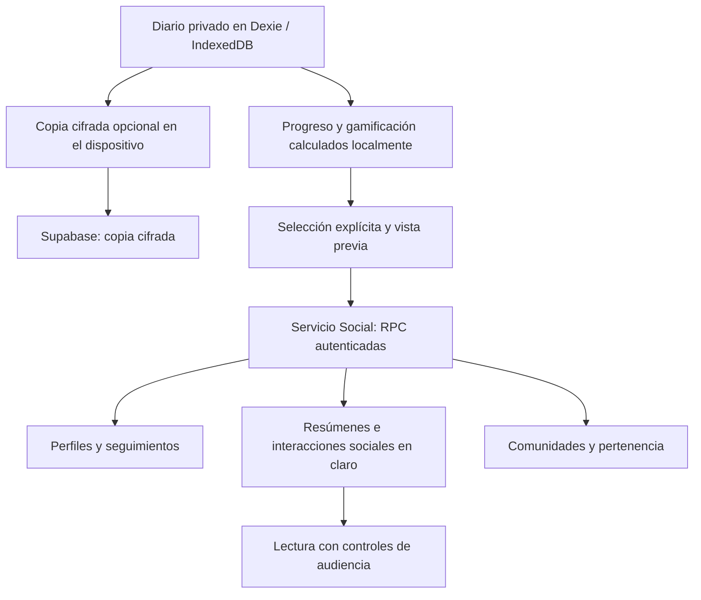

# Auditoría y propuesta de evolución del sistema social de AppFit

**Fecha:** 18 de octubre de 2026 · **Repositorio:** `/workspace/appfit` · **Revisión:** `6fb3569f16ee8b4488f6a906af5c493fc62d534a`.

**Alcance:** investigación, análisis y propuesta. No se ha modificado código de AppFit, instalado dependencias, ejecutado migraciones, accedido a cuentas reales ni publicado cambios. El informe y sus matrices se archivan en `docs/auditoria-social-2026-10-18/`; las propuestas siguen pendientes de autorización para implementarse.

**Índice:** [Resumen](#1-resumen-ejecutivo) · [Estado actual](#2-estado-actual-de-appfit) · [Benchmark](#3-benchmark-competitivo) · [UX/UI](#4-auditoría-uxui) · [32 propuestas](#5-catálogo-de-propuestas) · [Rediseños](#6-propuestas-de-rediseño) · [Priorización y top 10](#7-priorización-y-top-10) · [Roadmap](#8-roadmap-incremental-sugerido) · [Decisiones](#9-preguntas-y-decisiones-de-producto-pendientes) · [Fuentes](#10-fuentes-y-fecha-de-consulta).

**Tablas editables:** [benchmark](benchmark-appfit-social-2026-10-18.csv), [catálogo completo](catalogo-appfit-social-2026-10-18.csv) y [priorización](priorizacion-appfit-social-2026-10-18.csv). CSV en UTF-8 con BOM y separador punto y coma, para facilitar su apertura en una hoja de cálculo en español.

## Cómo leer el informe

- **V — Verificado en código:** existe una implementación conectada con la interfaz o el servicio. No demuestra que esté desplegada ni que funcione en producción.
- **T — Comprobado mediante pruebas ejecutadas:** se indica exactamente qué se ejecutó y sus límites.
- **D — Documentado por el fabricante:** una fuente oficial describe la función; no equivale a una prueba de una versión instalada.
- **U — Opinión de usuario:** señal cualitativa, con selección y antigüedad; no representa al conjunto de usuarios.
- **I — Inferencia:** interpretación razonada de la evidencia; requiere validación.
- **P — Propuesta:** comportamiento sugerido para AppFit, todavía no implementado.
- **NV — No verificable en esta auditoría:** no debe interpretarse como ausencia de la función.

Las referencias **E01–E24** remiten al inventario de evidencias del repositorio. Las referencias **S01–S31** son enlaces externos, definidos al final. La prioridad y el impacto esperado son juicios de producto, no métricas observadas.

**Límite de la inspección visual.** Se revisaron JSX, CSS, tokens, componentes compartidos, flujos y scripts existentes. Se intentó arrancar la aplicación con el Supabase falso del proyecto. Faltan `@supabase/supabase-js` y `@dnd-kit/core` en las dependencias disponibles, por lo que no fue posible completar el recorrido visual. No se instalaron. No hay capturas nuevas de AppFit, mediciones de geometría en navegador ni prueba en iPhone, Android o PWA instalada. Las conclusiones visuales se identifican como auditoría estática o hipótesis, sin atribuirles una validación que no tienen. El contenido del `dist/` preexistente no se usó para representar esta revisión.

**Investigación externa.** Primero se inspeccionó el repositorio; después se consultaron páginas oficiales disponibles el 18/10/2026 de los trece referentes solicitados y de Apple Fitness y The Conqueror. Se contrastaron documentación de ayuda, páginas de producto, material ilustrado y dos conversaciones de usuarios. No se instalaron esas aplicaciones ni se verificaron todas sus variantes de plataforma, país o suscripción. Los vídeos enlazados por los fabricantes se identifican como material de consulta; no se afirma haber reproducido sus interacciones. Una página que siga accesible puede describir una interfaz anterior.

## 1. Resumen ejecutivo

**AppFit ya tiene una base social considerable. Su mayor oportunidad es convertir los registros y logros en apoyo útil y continuidad compartida.** Añadir más superficies de conversación antes de mejorar la conexión entre las actuales aumentaría la complejidad.

1. **La base de confianza es una fortaleza.** El diario vive en el dispositivo; el usuario publica resúmenes expresamente, con vista previa. Seguimientos aprobados y comunidades tienen audiencias distintas. Hay bloqueos, denuncias y comprobaciones de acceso en las funciones SQL. Esto está implementado; su aplicación en el servidor real no se ha auditado aquí.
2. **Social está repartido entre varias identidades y destinos.** Social muestra actividad; Amigos gestiona personas y el perfil social; Perfil contiene datos corporales privados. El perfil de otra persona ofrece publicaciones, pero escaso contexto deportivo. La fricción de descubrimiento y orientación es una inferencia sólida del flujo, pendiente de pruebas de uso.
3. **La gamificación personal es más madura que la cooperación social.** Cumbres, Caminos, Ritmo, Vitrina y Liga aportan identidad y continuidad. Liga mide semanas de práctica por ejercicio: no es ELO, fuerza relativa ni una clasificación entre amigos. No se encontraron retos sociales, temporadas competitivas o un ranking de usuarios en la implementación inspeccionada.
4. **Hay inconsistencias de fiabilidad que deben preceder a nuevas funciones.** Borrar desde el feed requiere confirmación; desde el detalle publicado, no. El filtrado de filas incompatibles puede cortar anticipadamente la paginación. Los avisos pueden quedar desactualizados y ciertos errores no tienen una presentación visible.
5. **Los referentes más transferibles son Hevy para conectar identidad, progreso y rutinas; Strong y Fitbod para reutilizar entrenos; Strava para metas colectivas; Duolingo para compromisos pequeños; y Steam/Letterboxd para elegir qué representa a una persona.** Son principios adaptables, no una recomendación de copiar sus productos completos.
6. **La propuesta diferencial más coherente es “cada persona cumple su plan y el grupo avanza”.** Una semana compartida o una expedición cooperativa podría incluir a principiantes y avanzados sin ordenarles por kilos levantados. Necesita nuevos contratos de datos y consentimiento; hoy el servidor no conoce el historial privado completo.
7. **El crecimiento debe depender de capacidad operativa real.** La moderación se describe y modela de forma manual; las comunidades son de entrada abierta. Perfiles más ricos y descubrimiento público amplían la exposición y requieren controles acordes.

**Recomendación:** rediseño focal de la sección social, conservación de la navegación global y del sistema visual, una primera etapa de fiabilidad y claridad, y después un piloto de cooperación semanal. Posponer ELO, rankings globales, mensajería abierta, fotos y sesiones en directo hasta validar su utilidad.

## 2. Estado actual de AppFit

### 2.1 Inventario funcional y estado real

| Área | Qué existe | Estado y límites | Evidencia |
|---|---|---|---|
| Acceso | Social depende de la configuración de cuenta/Supabase; requiere sesión y perfil activo | V. No exige activar la copia cifrada. Sin configuración se oculta el destino | E01, E02 |
| Identidad social | Alias único y editable, nombre opcional, código de invitación regenerable | V. No se encontraron avatar, biografía ni disciplinas en el contrato o esquema social | E03, E04 |
| Perfil corporal | Datos físicos, objetivos y medidas en la sección Perfil | V y separado de la identidad social. No debe conectarse públicamente por defecto | E01, E03, E16 |
| Relaciones | Seguimiento dirigido con solicitud y aprobación; cancelar, dejar de seguir, quitar seguidor | V. “Os seguís” requiere dos relaciones aceptadas. Amigos no es una relación bilateral única | E04, E05 |
| Descubrimiento | Alias exacto o código; copiar y compartir código | V. No hay búsqueda aproximada, QR ni enlace de invitación navegable en el flujo inspeccionado | E05 |
| Publicaciones | Texto, resumen de entreno, actividad y logro conseguido | V. Texto hasta 2.000 caracteres; no se encontraron adjuntos fotográficos ni edición posterior de una publicación | E06, E07 |
| Entreno compartido | Duración, series, volumen, nombres de ejercicios, récords, ascensos, logros y mapa relativo | V. Resumen acotado; no es una copia de todas las series ni una rutina importable | E06, E08 |
| Actividad compartida | Tipo, título, duración, distancia y desnivel | V. El resumen no incorpora el recorrido GPS | E06 |
| Destinatarios | Seguidores aprobados o una comunidad | V. Son publicaciones separadas con distintos UUID e interacciones; no hay selector de campos individuales | E07, E09, E10 |
| Feed | “Siguiendo”, “Tú” y “Comunidades”; orden por fecha de publicación; cargar más | V. Página de 20; comunidades fuera del feed de seguidores. Hay un riesgo concreto al filtrar filas incompatibles | E09, E10 |
| Reconocimiento | Una reacción reversible, Ánimo, y comentarios | V. Reacción optimista con reversión ante error. Comentarios planos, hasta 500 caracteres; sin respuestas anidadas en el modelo | E11, E12 |
| Avisos | Reacciones y comentarios ajenos en publicaciones propias, más solicitudes | V. Hasta 30 avisos recientes; no son push, ni suscripción a todos los hilos donde participo | E13 |
| Comunidades | Buscar, crear, unirse/salir, publicar y denunciar; modo “solo publica el creador” | V. Entrada abierta a perfiles sociales; contenido para miembros. El creador puede editar descripción | E14, E15 |
| Gobierno de comunidad | Creador único y restricciones de autoría | Parcial respecto a una comunidad gestionable: no se encontraron moderadores delegados, expulsión comunitaria, transferencia o acceso por invitación | E14, E15 |
| Protección | Bloquear, denunciar perfiles/publicaciones/comentarios/comunidades; suspensión y cuotas SQL | V. Moderación manual prevista. No se ha verificado atención real a denuncias ni aplicación remota de permisos | E15, E16 |
| Progreso personal | Récords, gráficas y contexto de ejecución/carga, Vitrina y colecciones | V. Comparación consigo mismo; algunas piezas se pueden publicar explícitamente | E08, E17, E18 |
| Liga | Bronce → Plata → Oro → Zafiro → Rubí → Élite por semanas con un ejercicio | V. Cada tres semanas cambia de liga; Élite a las 16. Tras la gracia puede bajar por ausencia; pausas la congelan | E19 |
| Otras motivaciones | Cumbres sin plazo; Caminos; Ritmo semanal con pausas, comodines y reconocimiento de vuelta | V. Sistemas personales, no expediciones o retos sociales | E17, E20 |
| Competición entre personas | Comparación estructurada, rankings, duelos, temporadas, ELO | No encontrada en contratos, componentes y migraciones sociales revisados. No confundir Liga con estas funciones | E03, E19 |
| PWA y móvil | Manifest instalable, caché de recursos, safe areas, capas modales y adaptación de contenido | V. Social sigue dependiendo de red; no se encontró caché social persistente, cola de envío social ni push | E21, E22 |
| Funciones planificadas | Perfil enriquecido, nombre de reacción, push, recorridos con zona privada | Planificadas según roadmap, no implementadas por estar listadas. La documentación contiene discrepancias | E23 |
| Funcionamiento en producción | Ejecuciones históricas de migraciones y pruebas con cuentas descritas en docs | NV aquí. Son antecedentes documentales, no verificaciones ejecutadas en esta sesión | E23 |

### 2.2 Lo que conviene preservar

- **Compartir nace del entrenamiento.** El resumen se ofrece al terminar o desde el historial y los logros desde Vitrina. Aprovecha un momento con significado, sin exigir crear contenido arbitrario.
- **Publicación explícita y vista previa.** Es una base valiosa para ampliar formatos sin convertir todo el diario en contenido público.
- **Audiencias independientes.** Unirse a una comunidad no abre los diarios ni las publicaciones privadas de sus miembros.
- **Ánimo sencillo y reversible.** Hay respuesta inmediata y recuperación ante fallo; no necesita una economía de puntos para resultar útil.
- **Registros privados conservados al borrar contenido social.** El repositorio limpia la referencia publicada sin borrar el entrenamiento.
- **Motivación con descanso.** Cumbres no exige un plazo y Ritmo contempla pausas y vuelta. La Liga tiene descenso, por lo que no debe describirse toda la gamificación como carente de penalizaciones.
- **Componentes comunes.** Targets de diseño de 44 px, pestañas accesibles, capas con foco y aislamiento, texto alternativo del mapa y movimiento reducido son buenos cimientos. No equivalen por sí solos a certificar accesibilidad.

### 2.3 Navegación y flujos

**Descubrir y seguir:** Secciones → Social → icono de Amigos → Añadir → alias exacto/código → pedir seguir → esperar aprobación. El concepto real es seguimiento dirigido, aunque el destino se llame Amigos.

**Publicar entreno:** finalizar/abrir historial → bloque Compartir → vista previa → Publicar en Social. Compartir en comunidad abre un flujo adicional. No se puede añadir una nota al resumen adjunto en el editor actual: el textarea solo se muestra sin adjunto.

**Conocer a una persona:** desde el feed, tocar su nombre abre sus publicaciones; desde Amigos se abre primero una hoja de relación y después sus publicaciones si se la sigue. El resultado y los controles no son equivalentes.

**Entrar en comunidad:** Social → Comunidades → Descubrir → comunidad → unirse → ver contenido. El usuario debe afiliarse antes de evaluar las publicaciones. Es una decisión de acceso válida; necesita mejor contexto previo.

**Volver:** las capas compartidas sí gestionan Atrás. Las secciones principales se mantienen en `useState`, sin rutas propias, y al cambiar se reinician vista y scroll. No debe afirmarse que Atrás esté ausente en toda la app: la limitación es la navegación entre destinos y sus enlaces persistentes (E01, E21).

### 2.4 Arquitectura y datos



**Modelo remoto.** `perfiles` se relaciona con `auth.users`; `seguimientos` guarda dirección y estado; `bloqueos` limita visibilidad; `publicaciones` contiene `tipo`, fecha del evento, fecha de publicación, `resumen jsonb` y comunidad opcional; `reacciones` y `comentarios` dependen de la publicación. `comunidades` tiene creador y `miembros_comunidad` la pertenencia. `denuncias` conserva una instantánea del contenido denunciado. Hay cascadas de borrado.

**Seguridad implementada.** Las tablas sociales activan RLS y revocan acceso directo a los roles clientes. Las RPC `security definer` comprueban sesión, perfil, relaciones, pertenencia y bloqueos, con `search_path` fijado. Esto es una arquitectura razonable, pero la seguridad depende de esas comprobaciones y de su despliegue efectivo; la presencia de RLS no prueba por sí sola aislamiento correcto.

**Límite decisivo para nuevas funciones.** El servidor recibe solo resúmenes elegidos por el usuario. No puede deducir todos sus entrenamientos, cumplimiento del plan, serie comparable o trayectoria real a partir de sus publicaciones. Un perfil con “12 entrenos publicados” y otro con “12 entrenos realizados” requieren contratos distintos. Tampoco hay identificadores canónicos de ejercicio ni contexto completo de carga en el resumen actual: nombres de ejercicio y textos de récord no bastan para rankings fiables.

**Snapshot, no sincronización de historial.** Una publicación conserva el resumen enviado. Editar el entreno local o recalcular un logro no actualiza automáticamente el contenido remoto. Debe explicarse esta independencia antes de añadir estadísticas persistentes o retos.

**Cuotas existentes.** El SQL limita publicaciones a 30/día, solicitudes a 50/día, comentarios a 100/día y denuncias a 20/día; el resumen no supera 8 KB. Son frenos útiles, no un sistema completo contra abuso. Algunas cuotas cuentan filas existentes: no se deben presentar como un registro inalterable de todos los intentos.

### 2.5 Evidencias concretas del repositorio

| ID | Archivos y componentes | Qué fundamentan |
|---|---|---|
| E01 | [App](../../src/app/App.tsx#L28), [navegación](../../src/app/navegacion.ts#L4), [BottomNav](../../src/app/BottomNav.tsx#L19) | Router en estado, desmontaje por destino, media luna, separación Perfil/Social/Amigos |
| E02 | [servicio de cuenta](../../src/features/cuenta/servicio.ts#L9), [servicio social](../../src/features/social/servicio.ts#L4) | Activación por configuración y carga diferida |
| E03 | [contrato Social y MiPerfil](../../src/features/social/data/social.ts#L12), [esquema perfiles](../../supabase/migrations/0003_social.sql#L9) | Datos y operaciones realmente disponibles |
| E04 | [CrearPerfil](../../src/features/social/components/CrearPerfil.tsx#L36), [PerfilSheet](../../src/features/social/components/PerfilSheet.tsx#L85), [relación](../../src/features/social/lib/relacion.ts#L3) | Alias/nombre, autodeclaración 16+, relación dirigida, borrar perfil |
| E05 | [AmigosTab](../../src/features/social/AmigosTab.tsx#L109), [Añadir](../../src/features/social/components/Anadir.tsx#L29), [PersonaSheet](../../src/features/social/components/PersonaSheet.tsx#L102) | Descubrimiento, invitación textual y acciones de relación |
| E06 | [tipos y constructores de resumen](../../src/features/social/lib/publicacion.ts#L13) | Campos compartidos, límites, versión y ausencia de GPS |
| E07 | [CrearPublicacion](../../src/features/social/components/CrearPublicacion.tsx#L24), [CompartirLogro](../../src/features/vitrina/components/CompartirLogro.tsx#L8) | Destino, vista previa, texto o adjunto y logros obtenidos |
| E08 | [PublicarEntreno](../../src/features/gym/components/PublicarEntreno.tsx#L38), [Publicar](../../src/features/social/components/Publicar.tsx#L68) | Construcción del resumen, marca local y borrado desde el registro |
| E09 | [SocialTab](../../src/features/social/SocialTab.tsx#L74), [ListaFeed](../../src/features/social/components/ListaFeed.tsx#L32), [adaptador RPC](../../src/features/social/data/socialSupabase.ts#L19) | Pestañas, carga, filtrado, paginación y errores |
| E10 | [audiencias SQL](../../supabase/migrations/0006_comunidades_y_publicaciones.sql#L50), [feed SQL](../../supabase/migrations/0006_comunidades_y_publicaciones.sql#L243), [publicaciones por persona](../../supabase/migrations/0006_comunidades_y_publicaciones.sql#L272) | Acceso, orden, cursor y separación comunidad/seguidores |
| E11 | [PublicacionFeed](../../src/features/social/components/PublicacionFeed.tsx#L25), [reacción](../../src/features/social/lib/reaccion.ts#L7) | Ánimo optimista/reversible, botones y confirmación de borrado |
| E12 | [ComentariosSheet](../../src/features/social/components/ComentariosSheet.tsx#L49), [comentarios SQL](../../supabase/migrations/0005_feed.sql#L160) | Hilo plano, recuento, límite de 200 y recuperación |
| E13 | [AvisosSheet](../../src/features/social/components/AvisosSheet.tsx#L24), [AvisoAmigos](../../src/features/social/components/AvisoAmigos.tsx#L23), [avisos SQL](../../supabase/migrations/0006_comunidades_y_publicaciones.sql#L303) | Lectura, vistos y alcance de avisos |
| E14 | [Comunidades](../../src/features/social/components/Comunidades.tsx#L23), [modelo Comunidad](../../src/features/social/lib/comunidad.ts#L6) | Descubrimiento, detalle, creación y edición de descripción |
| E15 | [comunidades SQL](../../supabase/migrations/0006_comunidades_y_publicaciones.sql#L5), [solo creador](../../supabase/migrations/0007_comunidades_solo_creador.sql#L5), [edición descripción](../../supabase/migrations/0008_editar_descripcion_comunidad.sql#L5) | Pertenencia, cascadas y controles de autoría |
| E16 | [seguridad y moderación SQL](../../supabase/migrations/0003_social.sql#L58), [FormDenuncia](../../src/features/social/components/FormDenuncia.tsx#L16), [limpieza local al borrar](../../src/features/social/data/publicacionesRepo.ts#L4) | Protección implementada y frontera con datos privados |
| E17 | [logros](../../src/features/vitrina/lib/logros.ts#L17), [useVitrina](../../src/features/vitrina/hooks/useVitrina.ts#L10) | Categorías, logros nutricionales y recálculo local |
| E18 | [comparabilidad de ejecución](../../src/features/gym/lib/ejecucion.ts#L15), [récords](../../src/features/gym/lib/records.ts#L1) | Variantes, tipos de carga y límites para comparar personas |
| E19 | [Liga](../../src/features/liga/lib/liga.ts#L11) | Semanas, divisiones, gracia, descenso y pausa |
| E20 | [Cumbres](../../src/features/cumbres/lib/cumbres.ts#L1), [Ritmo](../../src/features/ritmo/lib/ritmo.ts#L1), [experiencia](../../src/features/experiencia/lib/experiencia.ts#L1) | Progresión personal, descansos y límites al plan |
| E21 | [Sheet](../../src/shared/components/Sheet.tsx#L20), [capas modales](../../src/shared/hooks/useModalLayer.ts#L26), [ModalPage](../../src/shared/components/ModalPage.tsx#L16) | Foco, Atrás en capas, viewport y retorno |
| E22 | [tokens](../../src/shared/design/tokens.css#L1), [CSS social](../../src/index.css#L609), [Button](../../src/shared/components/Button.tsx#L20), [ViewTabs](../../src/shared/components/ViewTabs.tsx#L13), [PWA](../../vite.config.ts#L19), [useConsulta](../../src/features/social/hooks/useConsulta.ts#L8) | Identidad real, adaptación y estrategia de carga |
| E23 | [roadmap](../roadmap.md#L62), [estado social](../features/social.md#L65), [plan histórico](../social.md#L74), [PRODUCT](../../PRODUCT.md#L23), [README](../../README.md#L1) | Planificación y contradicciones documentales; no sustituyen al código |
| E24 | [TarjetaPublicacion](../../src/features/social/components/TarjetaPublicacion.tsx#L36), [MapaPublicacion](../../src/features/social/components/MapaPublicacion.tsx#L8), [PublicacionesPersona](../../src/features/social/components/PublicacionesPersona.tsx#L14) | Jerarquía, métricas, significado del mapa y contexto del perfil |

### 2.6 Pruebas ejecutadas y lagunas

Se ejecutó la suite existente mediante:

```text
./node_modules/.bin/vitest run src/features/social src/features/liga src/features/vitrina src/features/ritmo src/features/cumbres src/app/navegacion.test.ts src/shared/design/contrast.test.ts
```

**Resultado T:** 354 pruebas aprobadas; 23 archivos de pruebas aprobados; un archivo no pudo cargarse (`social/data/socialSupabase.test.ts`) por falta de `@supabase/supabase-js`. El comando terminó con código 1. No se describe como una suite completamente verde. No se añadieron pruebas.

**No ejecutado:** build, suite completa, scripts de navegador, pruebas SQL contra PostgreSQL o Supabase real, pruebas de carga, lector de pantalla, permisos reales, envío de correo, instalación PWA ni medición de retención. El intento de servidor de desarrollo confirmó además la ausencia de `@dnd-kit/core`. Ambos procesos locales de prueba se detuvieron. No se usaron servicios reales como sustituto.

**Documentación que merece reconciliación posterior, sin editarla en esta tarea:** `PRODUCT.md` aún afirma “sin backend ni cuentas”; el código sí incluye ambos. README conserva una referencia al acento naranja, mientras los tokens actuales usan verde lima. El roadmap menciona push tanto entre pendientes como entre descartadas. Liga implementa descensos aunque algún principio documental hable de gamificación sin castigos. La decisión sobre qué mantener debe partir del comportamiento actual y de la intención de producto.

## 3. Benchmark competitivo

### 3.1 Referentes, comportamiento documentado y límites

| Producto | Hechos documentados relevantes (D) | Lectura para AppFit (I/P) | Límite de verificación |
|---|---|---|---|
| **Hevy** | Perfiles con historial, actividad y rutinas; feed de seguidos y descubrimiento; likes/comentarios; guardar/copiar rutinas; perfil privado y sesión privada [S01], [S02] | Relacionar persona → progreso → contenido reutilizable. Mantener consentimiento más selectivo en AppFit | Documentación actual; no se probaron apps. Las reglas de selección de Discover no se publican |
| **Strava** | Controles de perfil/actividad/mapa; kudos y comentarios; retos privados competitivos o de objetivo colectivo sin ranking [S04], [S05], [S06] | Separar reconocimiento y cooperación de competir. Una meta conjunta no necesita podio | Retos de grupo documentados como móviles y con suscripción/prueba; no asumir acceso universal |
| **Strong** | Compartir/importar entrenos y plantillas por enlace; formato actualizado en Strong 6.x [S07], [S08] | Social puede aportar utilidad al plan sin abrir un feed general. Versionar enlaces y formatos | Guía básica de 2021 contrastada con actualización de enlaces de 2024. No se verificó un feed interno equivalente |
| **Fitbod** | Enlaces de entreno adaptados al receptor; tarjetas de resumen. Clubs con feed y clasificación semanal de volumen/sesiones [S09], [S10] | Compartir estructura, adaptar esfuerzo. La pertenencia a un grupo necesita expectativas claras de publicación | Clubs es beta en ciertos gimnasios y accesos, con incorporación limitada a nuevas cuentas según la ayuda; no generalizar |
| **JEFIT** | Seguimientos, comentarios, grupos, mensajes privados, privacidad y concursos. Iron Points por entrenar y participar, canjeables por ventajas [S11] | Reconocer continuidad y ayuda útil; evitar pagar con puntos por publicar o reaccionar | Ayuda oficial consultada; no se comprobaron interfaz ni disponibilidad de cada variante |
| **Nike Run Club** | Retos individuales, comunitarios y personalizados por distancia/fechas; trofeos y medallas [S12] | Distinguir meta propia, meta compartida y competición al crear un reto | La ayuda diferencia acceso iOS/Android. No se verificaron cheers en directo ni su interfaz actual |
| **Garmin Connect** | Retos de pasos/distancia, grupos, likes, comentarios e insignias comparables con amigos [S13] | Dar contexto temporal y pequeñas colecciones a la constancia | Confirmado en producto; detalles finos de emparejamiento no verificables desde las páginas de soporte accesibles |
| **Freeletics** | Búsqueda/conexión con atletas; retos de constancia o repeticiones con fechas y visibilidad; ClapClap documentado [S14], [S15], [S16] | Lenguaje de reconocimiento propio y retos fáciles de explicar | Parte del material de ClapClap es antiguo. No se afirma que su pantalla de 2014 sea la actual |
| **Duolingo** | Ligas semanales por XP, agrupación por hábitos/zona horaria; misiones y rachas entre amigos; felicitaciones [S17], [S18], [S19] | Compromisos pequeños y metas cooperativas. En gimnasio, adaptar al plan semanal y al descanso | Las fuentes discrepan sobre elección de compañero y algunas plataformas; solo el principio queda suficientemente contrastado |
| **Discord** | Incorporación mediante preguntas para elegir roles/canales; guía y conversaciones organizadas [S20] | Una comunidad debe explicar para qué sirve y qué hacer primero | Configuración de onboarding en escritorio según ayuda. No trasladar su complejidad de canales a AppFit |
| **Reddit** | Reglas y moderación por comunidad; logros y rachas de participación, con control de visibilidad de insignias [S21], [S22] | Reglas claras, etiquetas y reconocimiento selectivo | No asumir que karma o rachas de abrir el feed mejoran entrenamiento; la ayuda de logros se actualizó en octubre de 2026 |
| **Letterboxd** | Diario ligado al objeto principal, favoritos, listas, seguimiento y actividad entrante [S23] | Identidad por elecciones: ejercicios/rutinas/logros destacados y listas útiles | Perfil/contenido generalmente públicos según su guía; esa apertura no encaja como valor por defecto de AppFit |
| **Steam** | Insignias, nivel y vitrinas configurables; logros destacados en perfil [S24] | Elegir pocas piezas representativas en vez de mostrar toda la colección | La presentación de cromos es histórica; el soporte de vitrinas se contrasta con documentación Steamworks |
| **Apple Fitness** | Compartir actividad con amigos; competición de siete días puntuada por porcentaje de objetivos, con techo diario; silenciar/ocultar actividad [S25] | El objetivo individual puede servir de denominador. Debe impedirse que entrenar de más dé ventaja ilimitada | No demuestra igualdad fisiológica: metas distintas y capacidad de ajustarlas afectan comparaciones |
| **The Conqueror** | Equipos suman distancias sobre una ruta virtual, con avance conjunto y recompensa individual [S26], [S27] | Referencia directa para evolucionar Caminos/Cumbres hacia cooperación | Requiere entrada por participante y tiene excepciones. No copiar monetización ni recursos de franquicias |

**Dos señales U:** en una conversación de Hevy se pide ocultar el componente social, mientras otro participante valora compartir con amistades reales [S28]. En una conversación de Fitbod se reclama seguimiento del progreso entre amigos [S29]. Son preferencias compatibles: permitir círculos pequeños y mantener el uso individual completo. Las conversaciones son anteriores a parte de las funciones actuales; no prueban que estas sigan faltando hoy.

**Cuidado con los números promocionales.** Las asociaciones entre uso social y continuidad publicadas por fabricantes, como Duolingo, no prueban el efecto causal que tendría una función en AppFit. No se trasladan multiplicadores de retención a este roadmap.

### 3.2 Matriz por funcionalidad y adaptación

Cada fila identifica implementaciones verificadas documentalmente, cómo funcionan, el problema que abordan, una decisión de diseño transferible, el equivalente actual de AppFit y los costes de adaptarlo. No mencionar un producto en una fila significa que no se ha acreditado aquí esa función.

| Funcionalidad | Referentes: funcionamiento y decisión interesante | Problema que resuelve | AppFit equivalente | Adaptación recomendada y ventaja | Inconveniente o condición |
|---|---|---|---|---|---|
| Perfil deportivo | Hevy reúne actividad/rutinas; Letterboxd destaca favoritos; Steam permite vitrinas [S02], [S23], [S24] | Reconocer a alguien y entender qué le interesa | Alias/nombre y publicaciones | B01: identidad breve y 1–3 hitos elegidos; más contexto sin abrir el diario | Nuevos campos y permisos; no confundir publicaciones con actividad total |
| Seguimiento privado | Hevy exige aprobar perfiles privados; Strava separa perfil y actividad [S01], [S04] | Controlar relaciones y exposición | Ya hay aprobación obligatoria | Preservar, explicando “seguir” y “te sigue”; audiencia visible | Más opciones pueden crear errores de comprensión |
| Descubrimiento | Hevy combina búsqueda y Discover; Freeletics permite encontrar atletas [S01], [S14] | Encontrar personas sin recordar todo el alias | Solo alias exacto/código | B04: invitación directa; D06: descubrir por afinidad con opt-in posterior | Enumeración, spam y arranque con poca comunidad |
| Feed de actividades | Hevy muestra sesiones; Strava integra reconocimiento sobre la actividad [S01], [S06] | Saber qué hicieron las personas relevantes | Feed cronológico existente | A06/A07: tarjetas más legibles, actualizar sin perder posición | No justifica un algoritmo de engagement ni scroll infinito |
| Reacción rápida | Strava usa kudos; Freeletics, ClapClap [S06], [S16] | Apoyar sin redactar | Ánimo reversible | A05: hacer legible “Ánimo” y mantener reversión | Strava no permite quitar kudos; esa restricción no aporta valor a AppFit |
| Conversación contextual | Hevy permite comentarios/respuestas; JEFIT documenta comentarios y mensajes [S01], [S11] | Preguntar y recibir respuesta sobre el entreno | Comentarios planos | B07/C05: hilos seguidos y preguntas ligadas al entrenamiento | Moderación y notificaciones; DM no es requisito |
| Plantillas reutilizables | Strong importa enlaces; Hevy guarda rutinas; Fitbod adapta entreno al receptor [S07], [S01], [S09] | Pasar de mirar a entrenar mejor | Solo resumen, sin receta de rutina | B05/B06: copiar estructura con revisión y pesos propios | Identificadores, versionado y manejo de ejercicios personalizados |
| Compartir hitos | Garmin destaca insignias; Duolingo propone felicitar hitos; Steam permite elegir insignia [S13], [S18], [S24] | Reconocer progreso con significado | Vitrina y compartir logro existentes | B01/B02: selección en perfil y resumen semanal | Puede revelar hábitos sensibles; no publicar automáticamente |
| Comparar fuerza | Hevy compara ejercicios y ofrece niveles por grupo de edad, sexo y peso [S03] | Dar una referencia de rendimiento | Comparación personal local | C03 primero: evolución propia consentida en paralelo | No hay datos equivalentes remotos; demografía no elimina diferencias técnicas |
| Meta colectiva | Strava tiene Group Goal sin ranking; The Conqueror suma recorrido [S05], [S26] | Motivarse juntos con distintas capacidades | Comunidades sin objetivo estructurado | C01/C02: cumplir el propio plan contribuye al grupo | Debe impedirse que una persona cargue con todo o reciba culpa |
| Reto entre amigos | NRC define distancia/periodo; Freeletics constancia/repeticiones; Apple porcentaje de objetivo [S12], [S15], [S25] | Dar un compromiso temporal explícito | No encontrado | C01, luego D01: meta aceptada, límites y empate permitido | Objetivos manipulables y sobreentrenamiento si se premia cantidad |
| Ligas/temporadas | Duolingo organiza semanas y ascensos; JEFIT concursos; Fitbod Clubs clasifica semanalmente en beta [S17], [S11], [S10] | Ritmo recurrente y pertenencia | Liga personal sin adversarios | D01 opcional y separada de Liga; clasificación de cumplimiento | Población insuficiente, presión y validación de datos |
| Comunidades útiles | Discord orienta por intención; Reddit aplica reglas específicas; JEFIT reúne planes y retos [S20], [S22], [S11] | Convertir pertenencia en participación | Comunidad abierta con feed y descripción | B08/B09: propósito, bienvenida, fijados y gobierno | Trabajo operativo; no crear docenas de grupos vacíos |
| Avisos y control | Hevy permite avisos de entrenos; Apple silenciar por amigo; Duolingo ofrece felicitaciones [S02], [S25], [S18] | Enterarse de algo relevante y poder limitarlo | Avisos de lo propio y banda de Inicio | A08/B07, después D04: respuestas y resumen discreto | Permisos, ruido y necesidad de un servicio de entrega para push |
| Identidad de largo plazo | Letterboxd organiza diario/listas; Steam colecciones; Garmin insignias [S23], [S24], [S13] | Hacer visible una trayectoria más allá del último post | Vitrina/Caminos/Cumbres locales | B01/C02: capítulos y piezas elegidas en perfil | No convertirlo en acumular puntos por pasar tiempo en la app |

### 3.3 Principios que encajan y patrones que conviene evitar

**Encajan:** objeto de entrenamiento como centro; contenido que permite aprender o reutilizar; reconocimiento rápido; identidad elegida; objetivos pequeños entre personas conocidas; cooperación con capacidad distinta; privacidad comprensible por acción.

**No encajan como dirección inicial:** feed general de fotos, ranking global por toneladas, recompensas por likes/comentarios, copiar rachas diarias de entrenamiento, mercado de insignias, mensajería no solicitada y descubrimiento masivo por popularidad. Son decisiones de encaje de producto, no afirmaciones de que esos patrones fallen universalmente.

**ELO.** No hay un enfrentamiento estandarizado en la mayoría de registros de gimnasio. Convertir tonelaje o constancia en “habilidad” produciría una precisión aparente. Para AppFit es más honesto hablar de cumplimiento, progreso y metas compartidas. Un modelo ELO solo merecería investigación si se definieran duelos comparables, resultados válidos y una necesidad de emparejamiento real.

## 4. Auditoría UX/UI

### 4.1 Hallazgos y soluciones

La severidad es heurística: **alta** si puede provocar pérdida de contenido social o impedir una tarea; **media** si dificulta orientación, comprensión o recuperación; **baja** para oportunidad de refinamiento. No se han observado tasas de fallo en usuarios.

| Hallazgo | Evidencia y alcance | Severidad | Solución sugerida | Naturaleza |
|---|---|---|---|---|
| Borrado con consecuencias distintas según entrada | `PublicacionFeed` confirma; `Publicar` llama directamente al borrado. En ambos casos desaparecen comentarios/reacciones (E08/E11) | Alta | Misma confirmación contextual desde cualquier origen; conservar siempre el entreno privado | Fiabilidad con componentes actuales |
| Paginación terminada antes de tiempo | El adaptador filtra filas con resumen inválido; `ListaFeed` decide `fin` por la longitud ya filtrada. Si una respuesta de 20 contiene una fila incompatible, recibe 19 y no ofrece continuar (E09) | Alta, condicionada a esas filas | Conservar cursor y señal de continuación de la respuesta original; probar también páginas enteras incompatibles | Contrato de lectura, sin nueva función social |
| Identidad repartida | Tres destinos: Perfil, Social y Amigos. Tu perfil social se abre con un icono de ajustes dentro de Amigos (E01/E04/E05) | Media | “Mi perfil deportivo” explícito desde Social; diferenciar “Datos personales” en el perfil privado | Arquitectura de información |
| Alta social con desvío | Sin perfil, Social manda a Amigos para crearlo (E09) | Media | Crear perfil en el punto de entrada y volver al contexto anterior | Flujo, sin nuevos datos |
| Nombre de otra persona abre superficies diferentes | Feed → publicaciones; Amigos → acciones → publicaciones; en comunidad el autor ni siquiera recibe el callback para abrir persona (E05/E14/E24) | Media | Una entrada consistente al perfil; mostrar solo lo autorizado por la relación/contexto | Parte visual y parte B01 |
| Ausencia de vuelta contextual en Amigos | No hay botón explícito a Social en `AmigosTab`; depende de Secciones. `PublicacionesPersona` usa cierre “Amigos” aunque se abra desde Social (E01/E05/E24) | Media | Volver al origen real con etiqueta y estado conservados | Navegación local |
| Arranque social poco guiado | El feed vacío lleva a buscar personas; las comunidades están en otro nivel. Añadir exige conocer alias/código (E05/E09/E14) | Media, I de fricción | Dos caminos claros: invitar a alguien conocido o explorar comunidades; sin contenido ficticio | Estados vacíos |
| Ánimo visualmente ambiguo | En publicaciones ajenas se ve llama + número; el nombre completo vive en `aria-label` (E11) | Media, I de descubribilidad | Texto “Ánimo”/“Animado” visible además de estado accesible; conservar icono | Visual independiente |
| Demasiados contenidos con peso parecido en tarjeta | Métricas, lista de ejercicios, mapa, récords, ligas y logros comparten una tarjeta; texto puede llegar a 2.000 caracteres (E24) | Media, I de densidad | Priorizar un hito, 2–3 métricas y detalles desplegables; comparar en prueba a 320 px | Visual independiente |
| Falta actualización explícita del feed | `ListaFeed` carga al montar/cambiar versión o paginar. No ofrece “Actualizar” ni escucha retorno a primer plano (E09/E22) | Media | Actualización discreta, conservar scroll, indicar cuándo hay novedades; sin polling agresivo | Gestión de estado |
| Avisos vacíos pueden esconder un error | `SocialTab` pasa lista vacía si no hay datos; `AvisoAmigos` no aparece ante error; `AvisosSheet` puede mostrar un vacío ordinario (E13) | Media | Diferenciar sin novedades, no cargado, error y sin conexión; botón de reintento | Gestión de estados |
| Respuestas a conversaciones ajenas no generan seguimiento | `avisos()` consulta interacciones sobre publicaciones cuyo autor soy yo (E13) | Media | “Seguir conversación” y aviso de respuesta; permitir silenciar | Nueva función B07 |
| No hay feedback de conexión coherente | Social consulta red; `SiPuedePublicar` oculta el bloque si no obtiene perfil. No hay cola persistente social (E08/E22) | Media | Explicación de disponibilidad y borrador explícito; no prometer envío automático | Estado + B10 |
| Comentarios pueden quedar truncados | SQL devuelve los primeros 200; la hoja actualiza el recuento con `lista.length`. Más de 200 implica ocultar posteriores y recuento reducido (E12) | Media, condicionada al volumen | Cursor, carga adicional y total separado; no contar solo lo cargado | Escalabilidad de lectura |
| Pérdida potencial de texto al cerrar | El editor guarda texto solo en estado y permite cerrar sin comprobar cambios (E07) | Media | Proteger salida con cambios; más tarde guardar borrador por cuenta | A09 y B10 |
| Comunidad exige adhesión antes de valorar el contenido | Datos públicos: nombre, descripción y miembros. Contenido solo tras unirse (E14/E15) | Media, I de decisión | Mostrar propósito, reglas y permiso de publicación antes de unirse; vista previa de contenido solo si el creador lo autoriza | Metadatos/B08 |
| Comunidad depende enteramente de su creador | Borrar perfil elimina comunidades creadas y su contenido; bloquear al creador oculta su comunidad (E04/E10/E15) | Alta antes de crecer | Explicar consecuencias y diseñar transferencia/roles; revisar semántica de bloqueo comunitario | Modelo B09 |
| Cursor sin desempate | Feed y comunidad filtran `creada < cursor` y ordenan solo por fecha; empates en el límite pueden omitir filas (E10) | Baja ahora; aumenta con importación/lotes | Cursor compuesto fecha + UUID y orden determinista | Robustez preventiva |

**Aclaración sobre privacidad.** Los constructores automáticos omiten diario nutricional, medidas, peso corporal y GPS. Sin embargo, hay logros de nutrición compartibles y texto libre. La frase “tu nutrición no se publica” puede resultar demasiado absoluta: es más preciso explicar qué datos no se extraen automáticamente y qué contenido elegido sí se compartirá. El volumen, las marcas o el horario también pueden revelar información deportiva; deben figurar en la vista previa (E04/E06/E17).

**Validación de entrada remota.** Los clientes validan resúmenes al leer y la base limita tamaño y tipos generales. El SQL no valida cada campo de entreno/actividad ni elimina todas las claves desconocidas. No se ha demostrado una fuga del cliente actual; sí hay una dependencia excesiva de la forma del payload para futuros clientes. Conviene definir una lista de campos aceptados en servidor antes de enriquecer estadísticas o admitir integraciones.

### 4.2 Diseño visual y accesibilidad

La implementación actual usa **grafito, acento verde lima/volt y Saira**, con tokens comunes y temas claro/oscuro (E22). No recomiendo recuperar el naranja descrito en partes antiguas del README ni añadir una paleta diferente para Social.

**Conservar:** tarjetas para unidades de actividad, filas para personas, insignias propias de Liga/Vitrina, superficies neutras, acento reservado a actuar, jerarquía de tipografía existente y movimiento discreto.

**Refinar:** autor y audiencia antes del contenido; hito destacado antes que tonelaje; datos secundarios en gris con contraste suficiente; detalles expandibles con estado; menús de acciones secundarias; etiqueta clara para Ánimo. En personas, un avatar generado con iniciales o un símbolo deportivo puede aportar reconocimiento sin infraestructura de fotos.

**Accesibilidad V:** `aria-pressed` en reacciones, nombres accesibles de iconos, navegación por teclado en pestañas, `inert` y foco en capas, descripción textual del mapa, adaptación por contenedor y movimiento reducido. Los controles comunes reservan 44 px de altura. WCAG 2.2 AA establece 24×24 CSS px con excepciones en 2.5.8; los 44 px de AppFit son una decisión de diseño más amplia, no ese mínimo AA [S30].

**Pendiente de comprobar en ejecución:** foco visible, contraste efectivo de todos los estados, lectura de avisos nuevos, zoom/texto al 200 %, lector de pantalla, ausencia de desbordamientos, orden de lectura y acciones con teclado móvil abierto. Al usar contadores, el texto accesible debe describir la acción además del número; el color no debe ser el único cambio.

### 4.3 Móvil, escritorio y PWA

| Contexto | Implementación inspeccionada | Recomendación |
|---|---|---|
| Móvil 320–430 px | Contenido centrado, métricas que pasan a dos/una columnas por contenedor, controles con wrap | Dar prioridad a nombre, hito y acción. Una tarjeta extensa no debería obligar a recorrer todo el mapa para apoyar |
| Texto ampliado | Tokens en rem y adaptación por contenedor; no hay validación visual en esta sesión | Comprobar 200 % y cadenas largas; mantener botones descriptivos y evitar pestañas cada vez más numerosas |
| Teclado y safe areas | Sheet/ModalPage y utilidades de viewport compartidas | Formularios largos con acción en footer soportado, error junto al campo y borrador intacto al reintentar |
| Escritorio | Ancho de contenido 32 rem, ampliado a 48 rem desde el breakpoint de 48 rem; sheets limitados a 32 rem | Mantener lectura central. Columna secundaria opcional de personas/metas si aporta contexto; no es necesaria en la primera etapa |
| Cambio de sección | Vista desmontada por `key={tab}` y scroll reiniciado | Recuperar pestaña, filtros y posición social cuando se vuelve desde un perfil |
| Sin conexión | Recursos de PWA cacheados; llamadas sociales sin caché persistente específica | Separar registros privados disponibles de contenido social que necesita red. Borradores primero; caché de terceros solo con política de caducidad y borrado |
| Invitación desde otra app | Código textual y Web Share si está disponible; sin resolución de ruta social | B04 con enlace/QR y alternativa de código. Comprobar Safari frente a la PWA instalada y su sesión/almacenamiento |
| Push | No encontrado en el código | Es técnicamente posible en una PWA de pantalla de inicio compatible; requiere permiso contextual y entrega desde servidor [S31]. No equivale a estar implementado ni a ser gratuito de operar |

## 5. Catálogo de propuestas

Todas las fichas siguientes son **P**. “Baja/media/alta” es complejidad relativa a esta arquitectura, no una estimación de días. **P0**: corregir antes de ampliar; **P1**: primera evolución; **P2**: siguiente etapa/piloto; **P3**: explorar tras validación. Las referencias inspiran el principio; no implican que el referente implemente exactamente la adaptación.

### A. Quick wins

#### A01. Borrado coherente desde cualquier pantalla

- **Problema actual:** el detalle borra sin la confirmación del feed (E08/E11).
- **Descripción e interacción:** ofrecer la misma confirmación con el alcance concreto: publicación, comentarios y ánimos; cancelar sin cambios. El entreno privado se conserva.
- **Referencia:** convención ya implementada en el feed de AppFit.
- **Diseño UX/UI:** reutilizar `ConfirmacionDestructiva` en el bloque publicado, con error y reintento en línea.
- **Beneficio:** evitar pérdida accidental y hacer predecible una acción irreversible sobre contenido social.
- **Complejidad:** baja; existe servicio y componente. **Dependencias:** `Publicar`, `PublicacionFeed`, `publicacionesRepo`; sin tablas nuevas.
- **Riesgos:** duplicar diálogos o perder el foco al cerrar; probar las dos entradas y la respuesta perdida.
- **Prioridad recomendada:** P0.

#### A02. Paginación y recuentos que no ocultan contenido

- **Problema actual:** filas incompatibles acortan páginas; comentarios se limitan a 200; cursor sin desempate (E09/E10/E12).
- **Descripción e interacción:** separar filas visibles, cursor original, total y continuación. “Cargar más” debe seguir disponible aunque una página contenga formatos no soportados.
- **Referencia:** necesidad técnica propia; principio de continuidad del historial.
- **Diseño UX/UI:** conservar el botón actual y añadir aviso discreto de contenido no compatible, sin mostrar payloads técnicos.
- **Beneficio:** lectura completa y contadores honestos.
- **Complejidad:** media; afecta RPC y adaptador, aunque no cambia el modelo de publicaciones. **Dependencias:** contrato paginado y compatibilidad entre clientes.
- **Riesgos:** duplicados, saltos, bucles con páginas vacías y costes de conteo. El cursor compuesto puede salir después del fallo de filtrado.
- **Prioridad recomendada:** P0.

#### A03. Orientación clara entre Social, personas y datos privados

- **Problema actual:** perfil social escondido y retornos ambiguos (E01/E05/E24).
- **Descripción e interacción:** acceso visible a “Personas” y “Mi perfil deportivo” desde Social; volver al origen; alta social en contexto. Mantener la media luna global.
- **Referencia:** continuidad perfil/actividad de Hevy y Letterboxd [S02], [S23].
- **Diseño UX/UI:** acciones con icono y texto; distinguir el perfil deportivo de los datos personales.
- **Beneficio:** menor esfuerzo para encontrar personas y comprender la identidad pública.
- **Complejidad:** baja/media; cambiar composición y estado de navegación. **Dependencias:** shell y componentes existentes; enriquecimiento del perfil va aparte en B01.
- **Riesgos:** cambiar demasiados nombres a la vez; validar con tareas de búsqueda y retorno.
- **Prioridad recomendada:** P1.

#### A04. Primeros pasos y vacíos con una siguiente acción

- **Problema actual:** vacío social centrado en búsqueda exacta y comunidades con orientación textual (E05/E09/E14).
- **Descripción e interacción:** elegir entre invitar a alguien, explorar comunidades o compartir el primer entreno; cada acción abre su flujo real. Si no hay historial, llevar a Entreno.
- **Referencia:** onboarding por intención de Discord [S20].
- **Diseño UX/UI:** una acción principal por estado y una alternativa, sin simulación de usuarios o publicaciones.
- **Beneficio:** reducir el bloqueo inicial sin exigir una red de contactos previa.
- **Complejidad:** baja. **Dependencias:** estados actuales y navegación; no necesita recomendaciones automáticas.
- **Riesgos:** demasiadas llamadas a actuar o presionar a publicar. Permitir continuar usando AppFit individualmente.
- **Prioridad recomendada:** P1.

#### A05. Reconocimiento legible

- **Problema actual:** la llama no explica por sí sola la acción (E11).
- **Descripción e interacción:** “Dar ánimo”/“Ánimo dado”, contador y reversión al segundo toque; anunciar un fallo y recuperar estado.
- **Referencia:** kudos/ClapClap como reconocimiento ligero [S06], [S16].
- **Diseño UX/UI:** etiqueta breve visible, `aria-pressed`, sin añadir un carrusel de reacciones.
- **Beneficio:** entender y participar con una sola acción.
- **Complejidad:** baja; contrato existente. **Dependencias:** textos de reacción y botón compartido.
- **Riesgos:** anchura en 320 px y contadores que dominen visualmente. No otorgar XP por reaccionar ni por recibir reacciones.
- **Prioridad recomendada:** P1; conservar “Ánimo” hasta decidir si se cambia el nombre.

#### A06. Tarjetas que destacan el significado del entreno

- **Problema actual:** muchas métricas y logros con jerarquía similar (E24).
- **Descripción e interacción:** destacar un hito, duración y series; permitir desplegar ejercicios, mapa y resto de logros. Texto largo con “Ver más”.
- **Referencia:** tarjetas deportivas de Hevy/Fitbod [S01], [S09].
- **Diseño UX/UI:** autor → hito/título → métricas → detalle → acciones. Conservar tokens, mapa y datos existentes.
- **Beneficio:** lectura rápida y más contexto para apoyar, sin convertir volumen en la señal principal de valor.
- **Complejidad:** baja/media; presentación y estados locales. **Dependencias:** tarjeta y componentes actuales.
- **Riesgos:** ocultar información que la persona esperaba ver. La vista previa completa debe mostrar claramente todo lo que se enviará.
- **Prioridad recomendada:** P1.

#### A07. Actualizar sin perder el sitio

- **Problema actual:** feed y avisos no refrescan por retorno a primer plano (E09/E13/E22).
- **Descripción e interacción:** “Actualizar” y señal de novedades; al volver, comprobar con límites de frecuencia y dejar que el usuario incorpore nuevos posts sin salto de scroll.
- **Referencia:** continuidad de un feed de seguidos [S01].
- **Diseño UX/UI:** control discreto sobre la lista, estado “Actualizando” y fecha de última carga si falla.
- **Beneficio:** confianza en que lo mostrado está al día.
- **Complejidad:** media por concurrencia y preservación de estado. **Dependencias:** `ListaFeed`, `useConsulta`, invalidación por acciones/cuenta.
- **Riesgos:** carreras entre consultas, repetición de filas o consumo de batería; no requiere tiempo real continuo.
- **Prioridad recomendada:** P1.

#### A08. Avisos y conexión con estados honestos

- **Problema actual:** error/no cargado pueden parecer ausencia de avisos; compartir puede desaparecer (E08/E13).
- **Descripción e interacción:** distinguir “Sin novedades”, “No se pudo cargar” y “Necesita conexión”; permitir reintentar conservando contenido.
- **Referencia:** controles de aviso de Apple y transparencia del flujo actual [S25].
- **Diseño UX/UI:** `ErrorState` dentro de la hoja, estado de carga identificable y mensaje corto junto a la acción.
- **Beneficio:** el usuario sabe si tiene que esperar, reintentar o seguir usando sus registros locales.
- **Complejidad:** baja/media. **Dependencias:** consultas y componentes de estado; sin push.
- **Riesgos:** avisos repetitivos en cada pantalla; agrupar fallos de conectividad sin tapar errores específicos.
- **Prioridad recomendada:** P1.

#### A09. Salir del editor sin perder texto accidentalmente

- **Problema actual:** cerrar desmonta el estado del editor (E07).
- **Descripción e interacción:** si hay cambios, ofrecer continuar o descartar; conservar texto al pasar a vista previa y al fallar el envío. El borrador persistente queda en B10.
- **Referencia:** protección de trabajo iniciada en los formularios de AppFit.
- **Diseño UX/UI:** misma capa y acción de salida para botón, Escape, gesto y Atrás; sin diálogos al cerrar un formulario vacío.
- **Beneficio:** menos frustración en interrupciones móviles.
- **Complejidad:** baja/media por integrar todas las salidas. **Dependencias:** estado de cambios y capas existentes.
- **Riesgos:** bloquear indebidamente una salida o perder el foco. No enviar nada al cerrar.
- **Prioridad recomendada:** P1.

#### A10. Explicar Liga y audiencia en el lugar de uso

- **Problema actual:** “Liga” puede interpretarse como fuerza/ranking; las tarjetas no identifican siempre su audiencia y el texto de privacidad es absoluto (E06/E19/E24).
- **Descripción e interacción:** “Liga de constancia del ejercicio”; ayuda breve; etiqueta de seguidores o comunidad y explicación de que se comparte un resumen elegido.
- **Referencia:** separación de controles de Strava y progresión propia de AppFit [S04].
- **Diseño UX/UI:** metadatos y botón de información existentes, sin otra insignia ni tutorial obligatorio.
- **Beneficio:** expectativas y consentimiento mejor informados.
- **Complejidad:** baja; textos/contexto. **Dependencias:** tarjeta, ayuda de Liga y composición de publicación.
- **Riesgos:** prometer privacidad absoluta frente a texto libre, logros nutricionales o capturas de terceros.
- **Prioridad recomendada:** P1.

### B. Mejoras de producto

#### B01. Perfil deportivo elegido por la persona

- **Problema actual:** alias y nombre aportan poco contexto y las acciones están repartidas (E03/E24).
- **Descripción e interacción:** avatar de catálogo/iniciales, biografía breve, disciplinas y 1–3 logros fijados; publicaciones accesibles según audiencia; vista “Así lo ven”.
- **Referencia:** Hevy, favoritos de Letterboxd y vitrinas de Steam [S02], [S23], [S24].
- **Diseño UX/UI:** cabecera compacta; “Seguir” y relación visibles; estadísticas solo si se eligen y explican.
- **Beneficio:** identidad reconocible sin hacer públicas medidas o historial completo.
- **Complejidad:** media. **Dependencias:** nuevos campos, RPC, reglas de visibilidad y UI unificada de persona.
- **Riesgos:** suplantación tras cambios de alias, biografías abusivas y ambigüedad de audiencia. Fotos subidas quedan fuera del primer alcance.
- **Prioridad recomendada:** P1.

#### B02. Resumen semanal que se comparte a propósito

- **Problema actual:** es fácil publicar una sesión, pero no transmitir continuidad sin varios posts (E06/E20).
- **Descripción e interacción:** generar localmente un resumen semanal de entreno/progreso elegido, mostrarlo completo y publicarlo como snapshot; fecha y periodo explícitos.
- **Referencia:** hitos de Garmin y felicitaciones de Duolingo [S13], [S18].
- **Diseño UX/UI:** tarjeta de semana con 2–3 datos y una frase propia; nutrición excluida por defecto.
- **Beneficio:** reconocer el proceso y reducir ruido.
- **Complejidad:** media. **Dependencias:** formato versionado, agregación local y compositor.
- **Riesgos:** publicar datos privados no revisados o presentar semana incompleta como total definitivo. Recalcular localmente no debe alterar silenciosamente el post.
- **Prioridad recomendada:** P2.

#### B03. Compositor único con control de contenido y destino

- **Problema actual:** publicar a seguidores y a comunidad usa caminos distintos; los adjuntos no admiten nota ni ocultar métricas (E07/E08).
- **Descripción e interacción:** elegir destino, añadir contexto y seleccionar qué mostrar: por ejemplo, hito sin kilos. Publicar explícitamente cada copia; ver dónde se ha compartido.
- **Referencia:** privacidad por actividad en Hevy/Strava y tarjetas de Fitbod [S01], [S04], [S09].
- **Diseño UX/UI:** mismo editor desde entreno, logro y Social, vista previa final con audiencia destacada.
- **Beneficio:** mayor expresión y control con una gramática única.
- **Complejidad:** media/alta. **Dependencias:** resúmenes que soporten campos omitidos, validación SQL y compatibilidad de lectores.
- **Riesgos:** copias huérfanas o borrado incompleto; no cambiar automáticamente la audiencia de posts existentes.
- **Prioridad recomendada:** P1.

#### B04. Invitación por enlace y QR con alternativa de código

- **Problema actual:** compartir código obliga a abrir una pantalla y transcribirlo (E05).
- **Descripción e interacción:** compartir enlace revocable que resuelve una persona y ofrece pedir seguir; QR para el gimnasio; conservar entrada manual.
- **Referencia:** invitaciones/enlaces de Hevy y Strong [S01], [S07], [S08].
- **Diseño UX/UI:** una tarjeta “Invitar” con copiar enlace, compartir y mostrar QR.
- **Beneficio:** conectar con amistades reales con menos pasos.
- **Complejidad:** media/alta; no basta dibujar el QR. **Dependencias:** resolución de enlaces, sesión, fallback web/PWA y rotación de token.
- **Riesgos:** enlaces reenviados, indexación y diferencia Safari/PWA. El QR no acepta por sí solo un seguimiento ni revela actividad privada.
- **Prioridad recomendada:** P2.

#### B05. Compartir una rutina que otra persona pueda usar

- **Problema actual:** el resumen de entreno no contiene estructura importable (E06/E18).
- **Descripción e interacción:** publicar plantilla con ejercicios canónicos, series/rangos y descansos; el receptor revisa, cambia material y guarda copia con sus cargas, sin copiar marcas ajenas.
- **Referencia:** Strong, Hevy y adaptación al receptor de Fitbod [S07], [S01], [S09].
- **Diseño UX/UI:** tarjeta “Ver rutina” → revisión → “Guardar en mis rutinas”.
- **Beneficio:** utilidad deportiva directa y motivo para volver a una relación/comunidad.
- **Complejidad:** alta. **Dependencias:** payload versionado, catálogo estable y mapeo de personalizados; copia local con autoría.
- **Riesgos:** duplicados, nombres ambiguos, material incompatible y asumir que una rutina ajena es adecuada para todos.
- **Prioridad recomendada:** P2.

#### B06. Guardados y colecciones de entrenamiento

- **Problema actual:** lo interesante del feed se pierde al desplazarse; no hay biblioteca social reutilizable.
- **Descripción e interacción:** guardar rutinas/publicaciones autorizadas; colecciones privadas como “Casa” o “Torso”; volver al original si sigue accesible.
- **Referencia:** listas de Letterboxd y guardar rutinas en Hevy [S23], [S01].
- **Diseño UX/UI:** “Guardar” secundario y biblioteca dentro del perfil deportivo; sin sumar otra sección global.
- **Beneficio:** convertir descubrimiento en planificación.
- **Complejidad:** media; alta si incluye sincronización. **Dependencias:** identificador de publicación/plantilla, reglas de acceso y repositorio local.
- **Riesgos:** conservar contenido revocado. Un marcador no concede acceso permanente; una rutina copiada debe distinguirse del post original.
- **Prioridad recomendada:** P2; posterior a B05 si se centra en rutinas.

#### B07. Conversaciones que puedo seguir y silenciar

- **Problema actual:** avisos solo para el autor y comentarios sin respuesta estructurada (E12/E13).
- **Descripción e interacción:** responder a un comentario, seguir/dejar de seguir el hilo y recibir actividad entrante; agrupar nuevos mensajes por publicación.
- **Referencia:** respuestas de Hevy y actividad entrante de Letterboxd [S01], [S23].
- **Diseño UX/UI:** un nivel de respuesta como máximo al empezar; bandeja con contexto, no conversación genérica.
- **Beneficio:** que preguntar produzca una conversación recuperable.
- **Complejidad:** media/alta. **Dependencias:** relación de respuesta, suscripciones, cursor de lectura y eventos de aviso.
- **Riesgos:** spam, menciones y notificaciones excesivas; respetar salida de comunidad, bloqueos y borrados.
- **Prioridad recomendada:** P2. No necesita push ni DM en el primer alcance.

#### B08. Comunidades con propósito, bienvenida y actividad visible

- **Problema actual:** nombre, descripción y recuento no explican qué hacer al unirse (E14).
- **Descripción e interacción:** categoría/disciplinas, reglas breves y publicación fijada; indicador de actividad reciente sin exponer contenido privado; sugerir una primera acción.
- **Referencia:** onboarding de Discord y reglas de Reddit [S20], [S22].
- **Diseño UX/UI:** propósito y permisos antes de “Unirme”; bienvenida compacta después; “Mis comunidades” con novedades.
- **Beneficio:** pertenencia más informada y menos grupos vacíos.
- **Complejidad:** media. **Dependencias:** metadatos, fijados y consulta de actividad con límites.
- **Riesgos:** prometer actividad inexistente o hacer públicas participaciones sensibles. Dar preferencia a pocas comunidades cuidadas.
- **Prioridad recomendada:** P2.

#### B09. Comunidades que pueden gobernarse y sobrevivir al creador

- **Problema actual:** creador único, acceso abierto y borrado en cascada de contenido comunitario (E04/E15).
- **Descripción e interacción:** transferir propiedad, delegar moderación, retirar contenido y expulsar miembros con reglas; elegir comunidad abierta o por invitación en una evolución separada.
- **Referencia:** roles de Discord y moderación de Reddit [S20], [S22].
- **Diseño UX/UI:** controles de administración solo a quien corresponda; consecuencias claras al borrar/salir.
- **Beneficio:** continuidad y capacidad operativa antes de crecer.
- **Complejidad:** alta. **Dependencias:** roles, permisos RPC, auditoría de acciones y cambio deliberado de cascadas.
- **Riesgos:** abuso de autoridad, pérdida accidental, bloqueo al creador y propiedad sin responsable. Revisar estas reglas antes de aumentar descubrimiento público.
- **Prioridad recomendada:** P1 si se abren comunidades a más personas; P2 en un piloto pequeño controlado.

#### B10. Borradores y reintento explícito en conexión inestable

- **Problema actual:** editor en memoria y posibilidad de perder contexto tras una interrupción (E07/E22).
- **Descripción e interacción:** guardar borrador local por cuenta y destino; mostrar “Pendiente de enviar”; pedir revisión al volver y enviar al pulsar, con UUID estable para evitar duplicados.
- **Referencia:** prioridad offline de AppFit y reintento idempotente ya existente.
- **Diseño UX/UI:** bandeja de borradores dentro del editor; estado distinto de “Publicado”.
- **Beneficio:** compartir tras entrenar con mala cobertura.
- **Complejidad:** media/alta. **Dependencias:** persistencia local, separación por usuario, caducidad y validación de permisos al enviar.
- **Riesgos:** dispositivo compartido, cuenta cambiada y destino revocado; borrar borradores al cerrar sesión según decisión explícita. No habilitar envío silencioso en segundo plano por defecto.
- **Prioridad recomendada:** P2.

### C. Funcionalidades diferenciales

#### C01. Semana en compañía: cada persona cumple su plan

- **Problema actual:** comunidades y seguimientos permiten observar, pero no acordar una meta deportiva estructurada.
- **Descripción e interacción:** dos personas aceptan un pacto semanal con sus objetivos individuales; comparten cumplimiento acotado, se animan y celebran al terminar. Permitir pausa y cierre sin reproches.
- **Referencia:** misiones de Duolingo, Group Goal de Strava y porcentaje de objetivo de Apple [S19], [S05], [S25].
- **Diseño UX/UI:** tarjeta de dos avances, sin ordenar a las personas por fuerza; detalle de reglas antes de aceptar.
- **Beneficio:** vincular relación y entrenamiento, incluso con niveles diferentes.
- **Complejidad:** alta. **Dependencias:** pacto, aceptación, objetivo fijado, periodo/zona horaria y agregado consentido que hoy no existe.
- **Riesgos:** metas artificialmente fáciles, culpa por el compañero y datos autodeclarados. Sin premios económicos ni ventaja por entrenar de más.
- **Prioridad recomendada:** P2; principal piloto diferencial.

#### C02. Expediciones cooperativas de Cumbres y Caminos

- **Problema actual:** la narrativa propia de AppFit es individual (E20).
- **Descripción e interacción:** pequeño grupo elige una ruta/cumbre simbólica y contribuye mediante una regla común explícita; cada persona ve su avance y el del equipo, con aportación limitada y reconocimiento de participación.
- **Referencia:** equipos de The Conqueror y Group Goal de Strava [S26], [S05].
- **Diseño UX/UI:** reutilizar lenguaje de montaña/ruta y añadir compañeros, etapas e hitos colectivos, sin sustituir el viaje personal.
- **Beneficio:** convertir identidad existente en una razón para entrenar con AppFit.
- **Complejidad:** alta. **Dependencias:** expedición remota, aportaciones versionadas, reglas de edición/borrado y consentimiento.
- **Riesgos:** mezclar km reales y metros simbólicos sin explicación, duplicar actividad o permitir que un participante domine.
- **Prioridad recomendada:** P2/P3 tras validar C01.

#### C03. Comparar trayectorias propias, con contexto

- **Problema actual:** se ven marcas sueltas sin una evolución comparable entre personas (E06/E18).
- **Descripción e interacción:** dos personas eligen qué progreso comparten; mostrar curvas respecto a su propia referencia y periodo, número de observaciones y tipo de carga; ocultar comparación cuando faltan datos.
- **Referencia:** comparación de ejercicios de Hevy [S01], [S03].
- **Diseño UX/UI:** dos pequeños paneles con escalas explicadas; sin “más fuerte” como conclusión automática.
- **Beneficio:** conversar sobre evolución y aprender del proceso.
- **Complejidad:** alta. **Dependencias:** ejercicio canónico, variantes/carga, línea base y nuevos agregados autorizados.
- **Riesgos:** porcentajes inflados desde bases pequeñas, cambios técnicos o datos incompletos. Para recién llegados, mostrar “creando referencia”, no cero progreso.
- **Prioridad recomendada:** P2/P3.

#### C04. Volver acompañado, con pausas respetadas

- **Problema actual:** Ritmo reconoce vuelta y pausa localmente, pero el apoyo social no tiene ese contexto (E20).
- **Descripción e interacción:** la persona decide compartir “Estoy retomando” o “En pausa”; un compañero puede enviar apoyo y acordar un objetivo más pequeño. No revelar motivo ni alertar de ausencias sin consentimiento.
- **Referencia:** racha entre amigos de Duolingo adaptada al descanso, y Ritmo de AppFit [S18].
- **Diseño UX/UI:** estado temporal opcional en perfil/pacto y mensaje breve, sin pérdida pública de una racha.
- **Beneficio:** incluir a quien regresa, sin reducirlo a una clasificación.
- **Complejidad:** media/alta. **Dependencias:** estado con caducidad, aceptación y controles de avisos.
- **Riesgos:** inferir lesión/enfermedad, presión y contacto no deseado.
- **Prioridad recomendada:** P2; validar tono antes de programar recordatorios.

#### C05. Preguntas útiles ligadas al entrenamiento

- **Problema actual:** el texto libre permite preguntar, pero falta contexto reutilizable y seguimiento.
- **Descripción e interacción:** adjuntar a una publicación “Busco alternativas de ejercicio/material” o “¿Cómo organizáis esta rutina?”; respuestas contextualizadas y guardables; autor puede señalar una respuesta útil.
- **Referencia:** conversaciones por tema de Discord/Reddit y rutinas compartidas [S20], [S22].
- **Diseño UX/UI:** etiqueta de intención y pregunta visible; respuesta útil dentro del hilo, sin karma global.
- **Beneficio:** que la comunidad ayude a planificar y resolver fricciones reales.
- **Complejidad:** media/alta. **Dependencias:** B05/B07, categorías y moderación.
- **Riesgos:** consejos inadecuados, apariencia de validación profesional o incentivos a acumular respuestas. No recompensar volumen de consejos.
- **Prioridad recomendada:** P2/P3.

#### C06. Atlas compartido del plan, sin carrera de volumen

- **Problema actual:** el mapa muestra trabajo relativo de una sesión y el Atlas es personal; no hay una cooperación centrada en variedad planificada.
- **Descripción e interacción:** grupo pequeño acuerda explorar ejercicios o patrones que ya caben en sus planes; cada persona marca y comparte un hito. El objetivo es completar una colección, no levantar más.
- **Referencia:** colecciones de Steam y Atlas/Vitrina de AppFit [S24].
- **Diseño UX/UI:** colección común con fichas y aportaciones, manteniendo el mapa como relativo, nunca diagnóstico de recuperación.
- **Beneficio:** dar valor a la diversidad y al aprendizaje, también con cargas pequeñas.
- **Complejidad:** alta. **Dependencias:** taxonomía, hitos consentidos y modelo de colección grupal.
- **Riesgos:** ejercicio innecesario para completar casillas y comparación de mapas no equivalentes.
- **Prioridad recomendada:** P3; probar interés mediante un reto manual antes.

### D. Apuestas exploratorias

#### D01. Temporadas optativas de cumplimiento

- **Problema actual:** no existe competición temporal para quienes la desean; Liga significa otra cosa.
- **Descripción e interacción:** ciclos breves en grupos pequeños, aceptación explícita y puntos por cumplir objetivos propios, con techo. Empates compartidos y salida sencilla; sin clasificar al resto de usuarios.
- **Referencia:** ligas de Duolingo y objetivos de Apple [S17], [S25].
- **Diseño UX/UI:** dentro de un reto, separado de Liga por ejercicio; reglas visibles y posibilidad de ocultar clasificación.
- **Beneficio:** probar competencia recurrente sin convertirla en el centro de AppFit.
- **Complejidad:** alta. **Dependencias:** C01, agregados, cierre de periodos, cohortes y revisión de actividad.
- **Riesgos:** manipular metas, falta de población, presión y ventaja por disponibilidad. No usar ELO ni prometer justicia demostrada.
- **Prioridad recomendada:** P3.

#### D02. Comparación de fuerza opcional y técnicamente comparable

- **Problema actual:** una marca textual no permite comparar ejecución, máquina o contexto (E18).
- **Descripción e interacción:** compartir marcas de pocos ejercicios normalizados, con regla de carga, periodo, variante y procedencia; elegir categorías y decidir si se muestra fuerza absoluta o relativa.
- **Referencia:** niveles y comparaciones de Hevy [S03].
- **Diseño UX/UI:** ficha por ejercicio y explicación de límites; sin “nivel físico global”.
- **Beneficio:** satisfacer competencia deportiva específica si existe demanda.
- **Complejidad:** alta. **Dependencias:** datos canónicos, normas de validación y consentimiento adicional para cualquier dato corporal.
- **Riesgos:** autodeclaración, máquinas distintas, técnica, selección de población y exposición de peso/edad. Una fórmula de normalización no certifica equidad.
- **Prioridad recomendada:** P3; no construir antes de C03 y entrevistas con principiantes.

#### D03. Entrenar juntos sin compartir cuenta

- **Problema actual:** se puede compartir un resumen, pero no coordinar una sesión.
- **Descripción e interacción:** sala privada con rutina común y preparación de cada persona; primero una cita y resultados posteriores; solo después explorar presencia en directo, sin imponer ritmo o cargas comunes.
- **Referencia:** adaptación de entrenos de Fitbod y grupos deportivos [S09].
- **Diseño UX/UI:** “Entrenar con…” desde rutina; participantes compactos fuera del área de registro de series.
- **Beneficio:** transformar una relación social en práctica conjunta.
- **Complejidad:** alta, especialmente en directo. **Dependencias:** B05, invitaciones, presencia/sesión, reconexión y conflictos.
- **Riesgos:** batería, distracción entre series, datos de presencia y falsa expectativa de sincronía en segundo plano de la PWA.
- **Prioridad recomendada:** P3; validar coordinación asíncrona primero.

#### D04. Push elegido para sucesos concretos

- **Problema actual:** los avisos requieren volver a abrir la aplicación (E13/E22).
- **Descripción e interacción:** activar desde una necesidad real —respuesta a mi pregunta o invitación aceptada—; elegir tipos, quiet hours y resumen; silenciar por persona/comunidad.
- **Referencia:** avisos por amigo de Hevy/Apple y soporte PWA de WebKit [S02], [S25], [S31].
- **Diseño UX/UI:** explicación antes del permiso del sistema; alternativa de bandeja interna siempre disponible.
- **Beneficio:** cerrar conversaciones útiles fuera de la sesión actual.
- **Complejidad:** alta. **Dependencias:** suscripciones por dispositivo, servicio de envío, deduplicación, borrado y rutas de destino.
- **Riesgos:** ruido, metadatos sensibles en pantalla bloqueada y endpoint caducado. No publicar mensajes con detalles corporales.
- **Prioridad recomendada:** P3; después de B07, sin notificaciones de culpa por no entrenar.

#### D05. Fotos y vídeo al servicio del entreno

- **Problema actual:** los resúmenes no permiten material visual propio.
- **Descripción e interacción:** explorar primero imagen de contexto opcional, con revisión de audiencia y borrado; vídeo técnico solo si hay utilidad probada y moderación disponible.
- **Referencia:** material adjunto a sesiones de Hevy [S01].
- **Diseño UX/UI:** adjunto secundario al entreno, sin autoplay ni feed independiente de selfies.
- **Beneficio:** expresión personal o intercambio deportivo más rico.
- **Complejidad:** alta. **Dependencias:** almacenamiento, procesamiento, límites, retirada de metadatos y controles de acceso.
- **Riesgos:** terceros en gimnasio, contenido corporal sensible, moderación, costes y rendimiento móvil.
- **Prioridad recomendada:** P3; no necesario para mejorar la base social.

#### D06. Descubrimiento por afinidad con participación voluntaria

- **Problema actual:** quien no conoce a nadie solo puede descubrir comunidades por nombre.
- **Descripción e interacción:** optar por aparecer según disciplina/material/interés declarado; sugerencias con motivo comprensible, ocultar y bloquear; empezar con directorio pequeño, no recomendador de popularidad.
- **Referencia:** Discover de Hevy y comunidades por interés [S01], [S20].
- **Diseño UX/UI:** apartado separado de Siguiendo, sin intercalar desconocidos en el feed privado.
- **Beneficio:** resolver arranque social sin importar contactos.
- **Complejidad:** alta al crecer. **Dependencias:** B01/B09, opt-in de descubrimiento, búsqueda con cuotas y retirada efectiva.
- **Riesgos:** exposición, sesgo hacia avanzados, spam y resultados vacíos. Nunca deducir afinidades de nutrición, medidas o ubicación privada.
- **Prioridad recomendada:** P3.

## 6. Propuestas de rediseño

### 6.1 Alcance recomendado: rediseño focal, no reconstrucción global

**Conservar:** media luna, Inicio orientado al registro/progreso, Entreno, datos locales, tarjetas de actividad y componentes compartidos. **Reorganizar:** acceso a personas, identidad deportiva, composición y contexto comunitario. **Añadir progresivamente:** perfiles elegidos, rutinas reutilizables y cooperación.

Hay dos niveles de cambio:

| Nivel | Cambios | Dependencias |
|---|---|---|
| Ajustes independientes de funciones nuevas | Nombres, retornos, estados vacíos/error, etiqueta Ánimo, jerarquía de tarjetas, ayuda de Liga y confirmaciones | Componentes actuales y gestión de estado |
| Rediseño apoyado en producto nuevo | Perfil deportivo rico, selector de campos, guardados, bienvenida fijada, pactos y expediciones | Contratos de B01/B03/B05/B08/C01; no simular controles sin respaldo |

No recomiendo reemplazar la navegación global por una barra de cinco pestañas únicamente por seguir una convención externa. La media luna forma parte de una decisión explícita del producto. Sí conviene medir si las tareas sociales frecuentes requieren pasos evitables y resolver primero las entradas dentro de Social.

### 6.2 Estructura sugerida de Social

**Primera etapa, con las funciones actuales:** mantener Siguiendo/Tú/Comunidades; añadir accesos legibles a Personas y Mi perfil deportivo, vuelta contextual y estados coherentes. Más adelante, al disponer de B01, “Tú” puede abrir el perfil deportivo completo sin duplicar una sección de identidad.

```text
SOCIAL                                    [Avisos · 2]
[Personas]                        [Mi perfil deportivo]

[ Siguiendo ] [ Tú ] [ Comunidades ]

[Compartir]     (abre texto o contenido disponible)

Lucía · @lucia.run                         [Opciones]
Para sus seguidores aprobados
Hoy he vuelto a completar mi plan
Entreno de torso · 42 min · 16 series
Récord personal: remo ...
[Ver ejercicios y mapa]
[Dar ánimo · 3]                  [Comentar · 1]

[Cargar más]

             [Secciones: media luna existente]
```

El rótulo de audiencia se construye a partir del contexto autorizado y, cuando haga falta, de metadatos nuevos. No debe deducirse de un alias ni mezclarse entre copias. Una publicación de texto usa su contenido como protagonista, sin un gran título genérico “Publicación” compitiendo con él.

### 6.3 Perfil deportivo

```text
[Volver al origen real]                    [Opciones]
[Iniciales/avatar]  Lucía Martín
                   @lucia.run · Os seguís
Fuerza / correr · Biografía elegida
[Siguiendo]                       [Gestionar relación]

DESTACADOS ELEGIDOS
[Mi primera cumbre] [12 semanas de constancia]

DATOS COMPARTIDOS
Periodo: últimas 4 semanas · actualizado el ...
“Resumen compartido por Lucía” / “Publicaciones”

[ Publicaciones ] [ Rutinas, cuando exista B05 ]
... contenido permitido ...
```

No mostrar seguidores como la métrica principal ni tratar la ausencia de estadísticas como falta de progreso. Si solo hay datos de publicaciones, nombrarlos así. Una persona de la misma comunidad no obtiene acceso al feed de seguidores por abrir el perfil: puede ver la identidad permitida y las publicaciones de esa comunidad, con el contexto correspondiente.

**Editar mi perfil:** identidad pública elegida, vista previa por audiencia y controles separados de mis datos corporales. En el primer alcance se puede usar avatar de catálogo para evitar almacenamiento de imágenes.

### 6.4 Composición y publicación

```text
COMPARTIR ENTRENAMIENTO
Publicar para: [Seguidores aprobados v]
Contexto opcional: [Hoy retomé después de una pausa...]

Mostrar en este resumen:
[x] Duración y series   [ ] Volumen
[x] Récord elegido     [x] Mapa muscular
[Ver todo lo que se enviará]

[Ver vista previa]

VISTA PREVIA
Para: Seguidores aprobados
... contenido exacto y completo ...
Los cambios en tu diario no actualizan esta publicación.
[Publicar]                              [Volver a editar]
```

Las opciones de campo dependen de B03: no son compatibles sin cambios con el esquema v1 que exige ciertas cifras. Mantener accesibilidad del formulario, un destino explícito y una acción final. Si se permite publicar en dos destinos, mostrar cada copia y su alcance de borrado, sin presentar dos copias como una sola publicación.

### 6.5 Comunidad y meta compartida

```text
COMUNIDAD: Fuerza en casa                  [Opciones]
Propósito · material y disciplina · permiso de publicación
[Reglas] [Miembros/administración si corresponde]
[Unirme] o [Miembro · Gestionar]

BIENVENIDA FIJADA             (B08)
Cómo participar · pregunta inicial opcional

SEMANA EN COMPAÑÍA            (solo tras C01)
Tu objetivo: 2 entrenos       1 de 2
Objetivo de Ana: 4 entrenos   2 de 4
Ambos estáis al 50 % de vuestro propio plan
[Dar apoyo] [Ver acuerdo]

PUBLICACIONES
[Compartir] ... feed del grupo ...
```

El prototipo textual no autoriza crear automáticamente un pacto para todos los miembros. Empezar por parejas conocidas que acepten la invitación. En una comunidad donde solo publica el creador, ofrecer comentar y animar con la misma claridad, sin un botón de publicación inoperante.

### 6.6 Criterios de interacción y estados

Cada superficie debe distinguir carga inicial, lista vacía, búsqueda sin resultados, datos anteriores con error de actualización, sin conexión, acceso retirado, suspendido y borrado. Tras un bloqueo o salida, volver a evaluar el acceso; no conservar contenido ajeno indefinidamente en una caché.

Reacciones pueden seguir siendo optimistas; publicaciones deben tener estado de envío y UUID estable. Proteger el texto durante reintentos. Preservar scroll al entrar/salir de perfiles. Microinteracciones breves de estado y logro, compatibles con movimiento reducido, sin confeti obligatorio, contadores animados o feedback que interrumpa registrar una serie.

## 7. Priorización y top 10

### 7.1 Criterios explícitos

Se valora **utilidad** para una tarea real; **participación/continuidad esperada**, especialmente volver a entrenar; **diferenciación** respecto al mercado; **esfuerzo** técnico y operativo; **dependencias**; **riesgo/incertidumbre** y **encaje** con AppFit. Las valoraciones son ordinales y discutibles. No se calcula una suma que dé una precisión falsa ni se utiliza RICE sin datos de alcance/confianza.

“Continuidad alta” significa hipótesis de efecto útil, nunca incremento medido. La confianza en un fallo de código es mayor que la confianza en el efecto de una nueva dinámica social.

| ID | Utilidad potencial | Participación/continuidad esperada | Diferenciación | Esfuerzo | Dependencia principal | Riesgo/incertidumbre | Encaje |
|---|---|---|---|---|---|---|---|
| A01 | Alta | Media | Baja | Bajo | Borrado actual | Bajo; fallo claro | Alto |
| A02 | Alta | Media | Baja | Medio | Contrato de páginas | Medio; escenarios concretos | Alto |
| A03 | Alta | Media | Media | Bajo/medio | Navegación local | Medio; validar nombres | Alto |
| A04 | Alta | Media | Baja | Bajo | Estados existentes | Medio; arranque sin red social | Alto |
| A05 | Media | Media | Baja | Bajo | Botón actual | Bajo/medio; comprensión | Alto |
| A06 | Alta | Media | Media | Bajo/medio | Tarjeta actual | Medio; falta prueba visual | Alto |
| A07 | Alta | Media | Baja | Medio | Invalidación/scroll | Medio; concurrencia | Alto |
| A08 | Alta | Media | Baja | Bajo/medio | Estados de consulta | Bajo/medio | Alto |
| A09 | Alta | Media | Baja | Bajo/medio | Capas/editor | Bajo/medio | Alto |
| A10 | Alta | Media | Media | Bajo | Ayudas/contexto | Bajo/medio | Alto |
| B01 | Alta | Media | Media | Medio | Campos/permisos | Medio; exposición | Alto |
| B02 | Media/alta | Media | Media | Medio | Agregación consentida | Medio | Alto |
| B03 | Alta | Media | Media | Medio/alto | Payload y validación | Alto; audiencia/copias | Alto |
| B04 | Alta | Media/alta | Baja | Medio/alto | Enlaces y PWA | Alto; sesión/exposición | Alto |
| B05 | Alta | Alta | Media | Alto | Rutina canónica | Medio/alto | Alto |
| B06 | Media | Media | Baja | Medio | Acceso y B05 | Medio; revocación | Alto |
| B07 | Alta | Media/alta | Baja | Medio/alto | Respuestas/eventos | Alto; abuso/ruido | Alto |
| B08 | Alta | Media/alta | Media | Medio | Metadatos/fijados | Medio; actividad suficiente | Alto |
| B09 | Alta al crecer | Media | Baja | Alto | Roles y cascadas | Alto; gobierno | Alto |
| B10 | Alta en mala red | Media | Media | Medio/alto | Persistencia por cuenta | Alto; privacidad local | Alto |
| C01 | Alta, por validar | Alta, por validar | Alta | Alto | Pactos y agregados | Alto; presión/demanda | Alto |
| C02 | Alta, por validar | Alta, por validar | Alta | Alto | C01 + expediciones | Alto; economía de avance | Alto |
| C03 | Media/alta | Media | Alta | Alto | Datos comparables | Alto; sesgos | Alto si es optativo |
| C04 | Alta, por validar | Alta, por validar | Alta | Medio/alto | Pausas consentidas | Alto; datos sensibles | Alto |
| C05 | Media/alta | Media/alta | Media | Medio/alto | B05/B07 | Alto; calidad de consejos | Alto |
| C06 | Media, por validar | Media | Alta | Alto | Colección grupal | Alto; propósito incierto | Medio/alto |
| D01 | Media para un segmento | Incierta | Media | Alto | C01 + población | Alto | Medio |
| D02 | Media para un segmento | Incierta | Media | Alto | C03 + reglas | Muy alto | Medio |
| D03 | Incierta | Incierta | Alta | Alto | B05 + coordinación | Muy alto | Medio/alto |
| D04 | Media/alta | Incierta | Baja | Alto | B07 + entrega | Alto; fatiga | Medio/alto |
| D05 | Incierta | Incierta | Baja | Alto | Storage/moderación | Muy alto | Medio |
| D06 | Media si hay población | Incierta | Baja | Alto | B01/B09 + opt-in | Muy alto | Medio |

### 7.2 Top 10 recomendado, en orden

| Orden | Mejora | Por qué va aquí | Qué validaría su valor |
|---|---|---|---|
| 1 | **A01 · Borrado coherente** | Evita pérdida accidental con una intervención acotada | Misma confirmación desde ambas entradas; cancelación y reintento correctos |
| 2 | **A02 · Paginación y recuentos** | Corregir lectura es previo a generar más contenido | Continuar tras filas incompatibles; no ocultar comentarios por el límite |
| 3 | **A03 · Orientación y perfil social accesible** | Reduce una fricción transversal sin rediseñar toda la app | Encontrar perfil/persona y volver al contexto sin ayuda |
| 4 | **A04 · Primeros pasos claros** | La red social no aporta si nadie sabe cómo empezar | Persona nueva logra invitar, explorar o compartir una actividad real |
| 5 | **A07 · Actualizar sin perder posición** | El feed debe resultar fiable en sesiones repetidas | Retorno a primer plano sin contenido obsoleto ni saltos inesperados |
| 6 | **A06 · Tarjeta legible y orientada al hito** | Mejora la lectura y la inclusión sin ampliar recogida de datos | Usuarios identifican el logro y cómo apoyar en móvil estrecho |
| 7 | **B01 · Perfil deportivo elegido** | Da contexto humano y reúne superficies dispersas | Se reconoce a alguien y se entiende qué ha elegido compartir |
| 8 | **B03 · Compositor con audiencia y campos** | Permite expresarse sin exponer cifras innecesarias | La persona predice con precisión qué verá cada destinatario |
| 9 | **B05 · Rutina reutilizable** | Añade utilidad deportiva concreta a la relación social | Una rutina compartida acaba en una sesión propia, revisada y adaptada |
| 10 | **C01 · Semana en compañía** | Mejor hipótesis diferencial para unir motivación, descanso y amistad | Parejas de distinto nivel quieren repetir y no sienten presión excesiva |

Las mejoras A05/A08/A09/A10 pueden agruparse con los trabajos anteriores por su bajo alcance. **B09 es una condición para expansión pública de comunidades**, aunque no se coloque por delante de todas las mejoras de uso en un piloto pequeño. El orden no autoriza implementación; sirve para elegir un bloque concreto cuando se decida avanzar.

### 7.3 Conceptos con potencial diferencial

**“Tu plan, nuestro avance” (C01/C02).** Una persona con dos sesiones y otra con cuatro pueden contribuir plenamente al cumplir su propio plan. El producto reconoce disciplina compartida, no la mayor fuerza ni más tiempo libre.

**“Se puede volver” (C04).** Un círculo que reconoce el regreso y permite pausar sin explicar por qué. Aprovecha una fortaleza actual de Ritmo, con una identidad social que también incluye descanso.

**“Me enseñas cómo entrenas; yo lo adapto” (B05/C05).** Rutinas compartidas, contexto y conversación, preservando cargas y decisiones individuales. Puede ser una razón práctica para invitar a alguien a AppFit.

**“Mi trayectoria, elegida por mí” (B01/B02/C03).** Destacar cumbres, caminos, constancia o pequeños récords sin publicar cuerpo, calorías ni toda la actividad. La identidad se construye por elecciones, no por rango universal.

### 7.4 Competir sin excluir a principiantes

Para el piloto C01 propongo, como regla experimental:

```text
cumplimiento semanal = 100 × min(sesiones que cuentan / objetivo acordado, 1)
```

Ejemplo: 2/2 y 4/4 equivalen a 100 %; 1/2 y 2/4 equivalen a 50 %. Una quinta sesión no da ventaja competitiva. No usar este porcentaje como medida de salud, esfuerzo fisiológico o calidad del plan.

La regla necesita resolver antes:

- **Qué cuenta:** usar una definición compatible con el plan y los registros confirmados. Los umbrales actuales de gamificación pueden no encajar en sesiones breves; no imponerlos universalmente sin estudiar esos casos.
- **Cuándo se acuerda:** fijar objetivo y zona horaria para el periodo, con cambios legítimos documentados. Una pausa no debe incentivar entrenar lesionado para evitar perder puntos.
- **Objetivo cero/pausa:** sin porcentaje ni división por cero; mostrar estado neutral. Si todo el grupo está en pausa, no generar un ganador ni un fallo.
- **Entrada y salida:** aceptar antes de participar; sin penalizar a un compañero por retirarse el otro. Ajustar reglas de equipo de forma transparente.
- **Datos incompletos:** diferenciar no compartido, sin referencia, pendiente y cero. Para principiantes, construir una referencia antes de comparar porcentajes de mejora.
- **Autodeclaración:** los datos locales no son una certificación remota. En un piloto amistoso puede bastar; no sostienen premios valiosos o un ranking competitivo público fiable.
- **Comparar fuerza:** exige ejercicio, máquina, carga, unilateralidad, variante y periodo compatibles. Dividir por peso corporal o agrupar por edad/sexo no elimina todas las diferencias y añade datos sensibles.
- **No premiar uso del feed:** sin puntos por likes, comentarios o aperturas diarias; nada debe invitar a registrar entrenos ficticios o a entrenar por encima del plan.

La cooperación puede usar aportaciones normalizadas, pero no debe presentarlas como kilómetros físicos o desnivel real. El denominador de grupo, las pausas y la recalculación al corregir datos necesitan una política comprensible antes del piloto.

## 8. Roadmap incremental sugerido

Las etapas se ordenan por dependencias, sin prometer fechas ni esfuerzo en semanas de desarrollo: se desconoce capacidad del equipo, población activa y presupuesto. Las duraciones de los pilotos que se sugieren son de observación, no estimaciones de implementación.

| Etapa | Alcance | Condición para empezar | Criterio de salida |
|---|---|---|---|
| **0 · Acreditar la base** | Resolver entorno de prueba cuando se autorice; reproducir A01/A02; revisar permisos/audiencias en instancia aislada; confirmar estado real de despliegue | Autorización posterior para trabajo técnico; ninguna instalación en esta auditoría | Suites y recorrido de dos cuentas de prueba completos; móvil/PWA real revisados; limitaciones documentadas |
| **1 · Claridad y fiabilidad** | A01–A10, empezando por pérdida/lectura y orientación | Base reproducible y bloque acotado aprobado | Sin pérdida de texto/borrado accidental; navegación y estados entendidos; no empeorar registro de entreno |
| **2 · Identidad y utilidad** | B01/B03; después B05 y B06. B08 para comunidades piloto y B09 antes de expansión; B04/B07/B10 según fricción observada | Definición de datos compartidos y modelo de audiencia | Personas reconocibles, publicación comprendida, rutina importada con contexto y moderación operable |
| **3 · Cooperación pequeña** | Prototipo de C01; C04 si encaja el tono. B02 como apoyo de resumen | Compromiso, pausas y reglas validados; agregado mínimo consentido | Participantes de distintos niveles desean repetir, pueden pausar y entienden su contribución |
| **4 · Narrativa compartida** | C02; explorar C03/C05; C06 solo con demanda | Evidencia favorable del piloto y capacidad operativa | Cooperación aporta valor al entrenamiento y no obliga a publicar más datos |
| **5 · Experimentos optativos** | D01–D06 de uno en uno | Pregunta y criterio de parada para cada experimento; población suficiente | Valor demostrable para un segmento sin dañar confianza, uso individual o rendimiento |

### 8.1 Dependencias de datos que deben diseñarse antes

**Perfil enriquecido:** campos elegidos, audiencia de cada sección y vista previa; no derivarlos automáticamente del perfil corporal. Alias es mutable: los vínculos estables nuevos deben resolver identidad mediante identificadores, sin depender de que un alias siga perteneciendo a la misma persona.

**Rutina compartida:** catálogo canónico, esquema versionado, tratamiento de ejercicios personalizados, autor, fecha y copia local. Nunca reutilizar IDs numéricos locales de ejercicios como identidades globales.

**Pacto semanal:** miembros que aceptan, objetivo/periodo/zona horaria, versión de reglas, estado, aportación mínima y fecha de actualización. Calcular en dispositivo y revisar antes de compartir. El servidor puede validar forma, cuotas y duplicados, pero no comprobar la verdad de un agregado sin acceder a datos adicionales. Esa limitación debe asumirse en el diseño.

**Correcciones:** distinguir eventos fuente y revisiones; actualizar o retirar aportaciones con reglas explícitas, evitando sumar dos veces. Separar la marca local `workout.publicacion` de un eventual registro de múltiples destinos y participaciones; un solo UUID no representa todas esas relaciones.

**Lectura y revocación:** en cada RPC nueva revisar seguidor, pertenencia, bloqueo y suspensión. Una caché o un guardado no conceden acceso permanente. No deshacer las garantías actuales al sumar funcionalidades.

**Coste:** imágenes, tiempo real y push cambian las cargas de almacenamiento, entrega y moderación. No presupuestarlos como “0 €” por el coste histórico del proyecto. Medir volúmenes y consultar condiciones vigentes cuando se decida construir, sin inventar una cifra en esta fase.

### 8.2 Cómo validar sin confundir participación con retención

**Primero, tareas de uso.** Proponer una sesión exploratoria con 6–8 participantes, incluyendo principiantes, personas con experiencia y al menos alguien que no quiera funciones sociales. Esta muestra es una propuesta, no un estudio ya realizado ni representativo. Tareas: crear identidad sin exponer medidas, invitar, aprobar, publicar a una audiencia, explicar lo que se envía, dar ánimo, volver desde una persona, corregir un error y pausar un pacto.

**Después, piloto de parejas durante 3–4 semanas de observación.** Preguntar qué interacción ayudó a entrenar o retomar, qué generó presión y si querrían repetir. Con población reducida, presentar casos y recuentos; no proclamar significación estadística.

| Indicador propuesto | Definición/denominador | Para qué sirve y límite |
|---|---|---|
| Activación social | Nuevos perfiles con una relación aceptada o comunidad con interacción útil / nuevos perfiles sociales del periodo | Detectar abandono inicial; separar relación de mera visita al feed |
| Tiempo hasta primer apoyo | Desde primera publicación hasta primera interacción de otra persona | Identificar contenido sin respuesta; no convertirlo en obligación de reaccionar |
| Conversación atendida | Preguntas con respuesta de otra persona / preguntas publicadas | Utilidad comunitaria, no cantidad total de comentarios |
| Rutina que se usa | Copias revisadas con al menos una sesión posterior / copias revisadas | Mide paso a entrenamiento; exige dato local o señal consentida nueva |
| Repetición de pacto | Parejas que aceptan otro periodo / parejas que finalizaron o pausaron el primero | Diferenciar pausa, abandono y deseo de repetir |
| Continuidad de entrenamiento | Participantes que vuelven a registrar entrenamiento en un periodo acordado / participantes elegibles de la cohorte | No inferible solo del feed. Medir localmente o mediante agregado mínimo voluntario |
| Comprensión de privacidad | Personas que predicen correctamente destinatarios y campos en una tarea | Medición de uso; no requiere telemetría del diario |
| Coste/daño social | Errores, bloqueos, denuncias, silencios y presión declarada, con denominador de usuarios/interacciones | Interpretar contexto; una subida de denuncias puede reflejar mejor acceso al botón |

No hay analítica de retención verificada en esta auditoría. La instrumentación sería otra decisión de producto y privacidad. Los registros de entrenamiento pueden permanecer locales; no se propone enviar nutrición, medidas o GPS para medir éxito social.

Comparar voluntarios sociales con no usuarios produce sesgo de selección. Si en el futuro hay volumen suficiente para un experimento, definir hipótesis y asignación antes; mientras tanto, combinar observación de tareas, entrevistas y recuentos longitudinales honestos. La métrica principal debe reflejar entrenamiento sostenido y apoyo útil, no tiempo de pantalla.

## 9. Preguntas y decisiones de producto pendientes

No bloquean esta entrega; orientan la elección de un siguiente bloque y no implican autorización para construirlo.

1. **¿A quién se abre AppFit primero?** Recomendación: amistades y pequeños grupos con propósito antes de descubrimiento general. La población y el soporte disponible condicionan el roadmap.
2. **¿Qué significa “perfil” en la interfaz?** Recomendación: perfil deportivo separado de datos personales; relación real de seguimiento dirigida explicada con claridad.
3. **¿Qué estadísticas se quieren compartir?** Recomendación: elegidas expresamente, con periodo y procedencia; ausencia visible en lugar de cero ficticio.
4. **¿Cambia “Ánimo”?** Recomendación: mantenerlo de momento y probar comprensión con texto visible. No necesita varias reacciones para aportar valor.
5. **¿Se permite ocultar kilos/volumen y añadir nota al entreno?** Recomendación: sí, mediante B03 y esquema compatible, sin fabricar valores cero para campos ocultos.
6. **¿Quién modera, con qué capacidad y qué respuesta se promete?** Recomendación: proceso operable antes de ampliar comunidades, incluidos retirada, transferencia y casos de bloqueo al creador.
7. **¿Qué pasa con contenido al salir o borrar el perfil?** Recomendación: hacer explícito el comportamiento actual y decidir qué cambia al introducir propiedad comunitaria y rutinas copiadas.
8. **¿Qué constituye una sesión que cuenta y un objetivo razonable?** Recomendación: compatible con planes reales, sin exigir entrenar diariamente. Cualquier scoring debe probarse con sesiones cortas y capacidades distintas.
9. **¿Qué puede automatizarse?** Recomendación: sugerir resúmenes y borradores; conservar publicación deliberada y aprobación de pactos. No avisar de ausencias a terceros sin elección previa.
10. **¿La Liga conserva descenso?** Recomendación: investigar cómo se entiende y se siente en cambios de rutina, descanso y retorno, antes de añadir temporadas sociales.
11. **¿Qué coste operativo se acepta?** Rutinas estructuradas y perfiles son una expansión distinta de fotos, push y sesiones en directo. Elegir un límite antes de comprometer estas últimas.
12. **¿Qué se quiere demostrar primero?** Recomendación: que una persona nueva entiende la sección, conecta con alguien y recibe apoyo útil; después, que una pareja quiere repetir una semana compartida.

## 10. Fuentes y fecha de consulta

**Todas consultadas el 18 de octubre de 2026.** “Oficial” acredita quién describe el comportamiento, no una prueba independiente ni acceso universal. Las citas se distribuyen junto a los hechos; las fichas de propuestas son adaptaciones originales. No se reproducen extensamente textos de terceros.

| ID | Fuente | Alcance y cautela |
|---|---|---|
| S01 | [Hevy — Social Guide], [S01] | Ayuda oficial: seguir, feed, comentarios, copiar, privacidad; con material ilustrado |
| S02 | [Hevy — Athlete Profiles], [S02] | Producto oficial y capturas publicadas: identidad, rutinas, actividad y avisos; no prueba del ejecutable |
| S03 | [Hevy — Strength Level], [S03] | Ayuda oficial: categorías y agrupación por sexo/edad/peso; no certifica equidad |
| S04 | [Strava — Privacy Controls], [S04] | Ayuda oficial fechada 14/09/2026: perfil, actividad y mapas |
| S05 | [Strava — Group Challenges], [S05] | Ayuda oficial: modalidades, Group Goal, suscripción y móvil; reglas pueden cambiar |
| S06 | [Strava — Kudos], [S06] | Ayuda oficial fechada 16/09/2026; no permite retirar kudos |
| S07 | [Strong — Share workout or template], [S07] | Guía oficial de 19/05/2021; contrastada con S08 |
| S08 | [Strong — Share Link Updates 6.x], [S08] | Guía oficial de 21/11/2024; incompatibilidad de enlaces antiguos |
| S09 | [Fitbod — Sharing a Workout], [S09] | Ayuda oficial actualizada 15/01/2026: adaptación al receptor y tarjetas |
| S10 | [Fitbod — Clubs], [S10] | Ayuda oficial actualizada 30/03/2026; beta restringida, no disponibilidad general |
| S11 | [JEFIT — FAQ], [S11] | Ayuda oficial: Social, Iron Points y concursos. No extrapolar módulos anunciados como futuros |
| S12 | [Nike — NRC Challenges], [S12] | Ayuda oficial, con diferencias de acceso iOS/Android y captura ilustrativa |
| S13 | [Garmin Connect — producto], [S13] | Página oficial accesible: retos, grupos, comentarios e insignias. Detalles de ayuda dinámica no comprobados |
| S14 | [Freeletics — Connect with other athletes], [S14] | Ayuda oficial: encontrar/conectar y foro |
| S15 | [Freeletics — Small Group Challenges], [S15] | Explicación oficial de modalidades y reglas; no se probaron variantes actuales |
| S16 | [Freeletics — ClapClap], [S16] | Explicación oficial histórica del gesto de reconocimiento; no usar como captura actual |
| S17 | [Duolingo — Leagues and Leaderboards], [S17] | Explicación oficial: semanas y agrupación; algunas notas de plataforma pueden estar desactualizadas |
| S18 | [Duolingo — Social Features], [S18] | Panorama oficial más amplio, rachas, felicitaciones y elección de compañero |
| S19 | [Duolingo — Friends Quests], [S19] | Explicación oficial de misión cooperativa; contradice S18 sobre elegir compañero. No se fija esa regla como universal |
| S20 | [Discord — Community Onboarding FAQ], [S20] | Ayuda oficial ilustrada: roles, canales y preguntas; configuración de escritorio |
| S21 | [Reddit — Achievements], [S21] | Ayuda oficial actualizada 05/10/2026; insignias, visibilidad y participación diaria |
| S22 | [Reddit — Disrupting Communities], [S22] | Política oficial: reglas específicas y moderación comunitaria |
| S23 | [Letterboxd — Welcome], [S23] | Guía oficial ilustrada: perfil, diario, favoritos, listas y actividad entrante; parte de funciones premium |
| S24 | [Steam — Trading Cards / Showcases], [S24] | Página oficial histórica, contrastada con [Steamworks: Profile Features](https://partner.steamgames.com/doc/marketing/profile?language=english). La página de ayuda de niveles devolvió solo una imagen; no se utilizó como evidencia detallada |
| S25 | [Apple — Share activity from Apple Watch], [S25] | Guía oficial: compartir, competir por objetivos y silenciar |
| S26 | [The Conqueror — Create or join a team], [S26] | Ayuda oficial: distancias agregadas, participación individual y excepciones |
| S27 | [The Conqueror — Virtual Tour], [S27] | Guía oficial del 11/08/2026 con vídeos; se identificó el material, no se certificaron sus flujos mediante reproducción |
| S28 | [r/Hevy — Disable Social Network], [S28] | U: preferencias contrapuestas, conversación anterior a esta auditoría; sin representatividad |
| S29 | [r/Fitbod — Progress sharing], [S29] | U: solicitud de ver progreso entre amigos; conversación de enero de 2025, anterior a Clubs beta |
| S30 | [W3C — Target Size Minimum], [S30] | Explicación oficial del criterio WCAG 2.2 2.5.8; no certificación de AppFit |
| S31 | [WebKit — Web Push for iOS/iPadOS], [S31] | Fuente oficial de soporte en apps de pantalla de inicio, permiso por interacción y entrega web push |

**Contrastes adicionales consultados:** [Hevy: comparar progreso](https://help.hevyapp.com/hc/en-us/articles/38223346135191-How-to-Compare-Your-Progress-With-Friends-on-Hevy), [Duolingo: Friend Streak](https://blog.duolingo.com/friend-streak/), [Reddit: Community Achievements](https://support.reddithelp.com/hc/en-us/articles/25564722077588-Community-Achievements), [Apple: envío Web Push](https://developer.apple.com/documentation/usernotifications/sending-web-push-notifications-in-web-apps-and-browsers) y [Garmin: gestión de retos](https://support.garmin.com/en-IN/?faq=ha8IW3tdd28jrjqPFXdSTA). Esta última no ofreció contenido detallado legible en la apertura; por ello no se afirman umbrales de emparejamiento ni reglas precisas a partir de ella.

**Repositorio:** evidencias E01–E24, código y SQL en la revisión indicada al principio. Los documentos de planificación se trataron como antecedentes y las pruebas históricas como información documental. La evidencia nueva de ejecución se limita a la sección 2.6.

[S01]: https://help.hevyapp.com/hc/en-us/articles/35688036014231-Hevy-App-Social-Guide-Connect-Follow-and-Share-Your-Workouts
[S02]: https://www.hevyapp.com/features/user-profiles/
[S03]: https://help.hevyapp.com/hc/en-us/articles/38001696749335-Strength-Level-Feature-How-Hevy-Compares-Your-Strength-by-Exercise
[S04]: https://support.strava.com/en-us/articles/15401951-privacy-controls
[S05]: https://support.strava.com/en-us/articles/15401736-how-do-group-challenges-work-on-strava
[S06]: https://support.strava.com/en-us/articles/15402054-what-is-kudos
[S07]: https://help.strongapp.io/article/109-share-workout-or-template
[S08]: https://help.strongapp.io/article/255-share-links
[S09]: https://help.fitbod.me/hc/en-us/articles/360006427453-Sharing-a-Workout-Gym-Location-Settings
[S10]: https://help.fitbod.me/hc/en-us/articles/38657483026967-Clubs
[S11]: https://www.jefit.com/support/faq
[S12]: https://www.nike.com/help/a/nrc-challenges/ntc-nrc
[S13]: https://connect.garmin.com/
[S14]: https://help.freeletics.com/hc/en-us/articles/115004676165-Connect-with-other-Free-Athletes
[S15]: https://www.freeletics.com/en/blog/posts/freeletics-small-group-challenges/
[S16]: https://www.freeletics.com/en/blog/posts/community-clapclap/
[S17]: https://blog.duolingo.com/duolingo-leagues-leaderboards/
[S18]: https://blog.duolingo.com/friends-social-features/
[S19]: https://blog.duolingo.com/friends-quests/
[S20]: https://support.discord.com/hc/en-us/articles/11074987197975-Community-Onboarding-FAQ
[S21]: https://support.reddithelp.com/hc/en-us/articles/27063106698004-What-are-achievements
[S22]: https://support.reddithelp.com/hc/en-us/articles/360043066412-Disrupting-Communities
[S23]: https://letterboxd.com/welcome/
[S24]: https://steamcommunity.com/tradingcards/
[S25]: https://support.apple.com/en-ie/guide/watch/apd68a69f5c7/watchos
[S26]: https://help.theconqueror.events/en/articles/4757658-create-or-join-a-team
[S27]: https://help.theconqueror.events/en/articles/5240526-virtual-tour-of-the-conqueror-challenges-app
[S28]: https://www.reddit.com/r/Hevy/comments/1hvh0w5/feature_request_disable_social_network/
[S29]: https://www.reddit.com/r/fitbod/comments/1ia2w8w/progress_sharing/
[S30]: https://www.w3.org/WAI/WCAG22/Understanding/target-size-minimum.html
[S31]: https://webkit.org/blog/13878/web-push-for-web-apps-on-ios-and-ipados/
